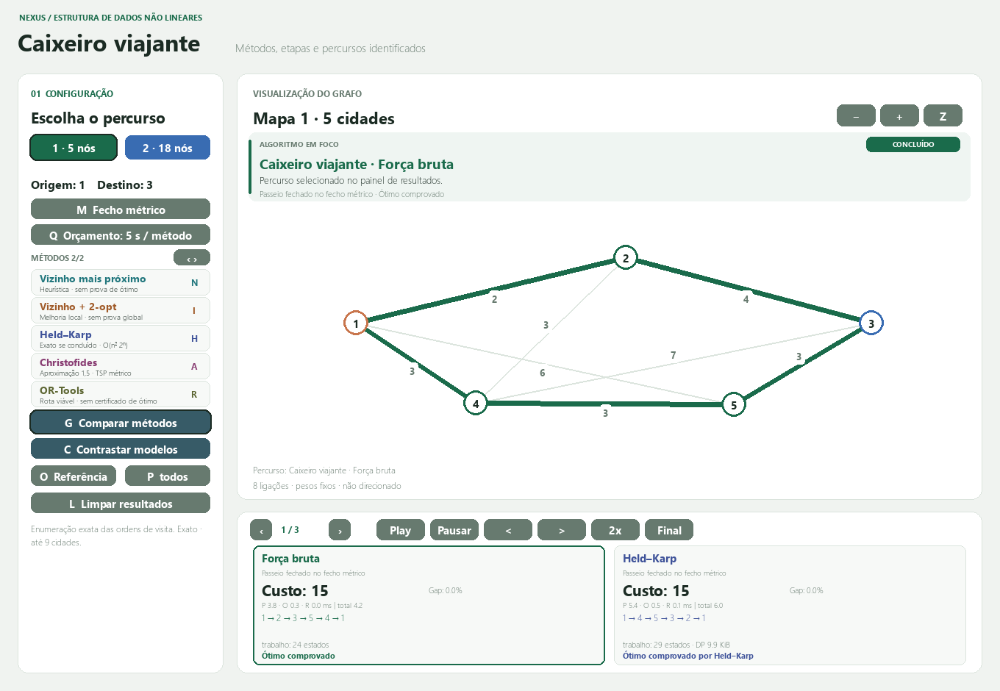

# NEXUS TSP 2D

Aplicativo acadêmico em **Python + Pygame** para explorar os dois grafos fixos da aula de Estrutura de Dados Não Linear. Permite escolher origem/destino, inspecionar pesos, calcular percursos e reproduzir os algoritmos passo a passo.

A faixa **Algoritmo em foco** identifica método, estado, etapa, modelo e garantia durante execução e reprodução. Há cinco novos métodos, seletor de modelo/orçamento e comparação entre solvers do mesmo problema. Veja a [entrega TSP-032](docs/integracao_solvers.md).



## Executar

Requer Python 3.10+. Ambiente conferido: Windows, Python 3.14 e pygame-ce 2.5.8, distribuição compatível com a API `pygame`.

```powershell
python -m venv .venv
.venv\Scripts\python.exe -m pip install -r requirements.txt
.venv\Scripts\python.exe main.py
```

Linux/macOS: usar `.venv/bin/python`. Não é necessário ativar o ambiente ou alterar a política de execução do Windows. A aplicação usa fontes locais e não exige conexão após a instalação.

OR-Tools é opcional: `.venv\Scripts\python.exe -m pip install -r requirements-ortools.txt`.
Foi instalado e testado OR-Tools 9.15.6755 neste Python 3.14/Windows. Sem ele,
a interface informa indisponibilidade e os outros algoritmos continuam disponíveis.

## Controles

| Comando | Ação |
|---|---|
| `1` / `2` | Alternar mapas |
| Clique nos nós | Definir origem e destino, alternadamente |
| `D` | Dijkstra: menor caminho A→B |
| `F` | TSP Hamiltoniano por força bruta, até 9 nós |
| `T` | Dijkstra + TSP isoladamente: fecho métrico, busca exata e percurso físico |
| `C` | Contrastar TSP direto e TSP no fecho; são modelos distintos |
| `B` | Branch-and-bound até 18 nós, com orçamento explícito |
| `Tab` / botão ‹ › | Alternar as duas páginas de métodos |
| `N` | Vizinho mais próximo (`nearest_neighbor`) |
| `I` | Pipeline `nearest_neighbor + two_opt` |
| `H` | Held–Karp exato com reconstrução, até 18 nós |
| `A` | Christofides no fecho métrico, até 18 nós |
| `R` | OR-Tools opcional, até 18 nós |
| `M` | Selecionar fecho ou original para N/I/H/R e comparação G |
| `Q` | Orçamento por método: 0,5 / 2 / 5 / 15 segundos |
| `G` | Comparar seis solvers no mesmo modelo/origem; gap com certificado |
| ‹ / › no cabeçalho de resultados | Alternar páginas da comparação |
| `X` / Cancelar | Cancelamento cooperativo da execução |
| Play / Pausar / `<` / `>` | Reproduzir histórico e navegar |
| Velocidade / Final | Mudar velocidade ou exibir resultado final |
| Clique no resultado | Destacar sua rota; clicar novamente restaura a comparação |
| `O` | Exibir/ocultar a referência original |
| `P` | Pesos: todos → do nó sob o cursor (ou origem) → ocultos |
| Roda / `+` / `−` | Zoom; roda ancorada no cursor |
| Arraste direito ou do meio | Mover o desenho |
| `Z` | Reset do zoom e posição |
| Cursor sobre aresta | Inspecionar par e peso, inclusive em cruzamentos |
| `L` / `Esc` | Limpar / sair |

Os algoritmos rodam em um worker; a reprodução usa o tempo entre frames. Seleções ficam estáveis enquanto há cálculo. Coordenadas servem ao desenho e não determinam pesos.

## Resultados e limitações

| Caso | Resultado |
|---|---|
| Mapa 5 | 5 IDs, 8 arestas; sem ligações 1–3 e 2–5 |
| Dijkstra 1→3 | 1–2–3, custo **6** |
| TSP direto e TSP no fecho, mapa 5 | Ambos com custo **15**; 24 ordens por origem fixa |
| Branch-and-bound | Mapa 18 real: custo ótimo **391**, confirmado também por Held–Karp |
| Mapa 18 real | Validado: 45 ligações e 45 pesos; **9–14 = 1** definido pelo usuário |
| Testes automáticos | **129 aprovados**, incluindo novos solvers, contratos, estados, comparação e integração SDL |
| Roteiro SDL | **31 casos aprovados**, com capturas renderizadas |
| Inspeção manual nativa | Pendente de conclusão |

O mapa 18 está validado e disponível para Dijkstra, B e os novos métodos. O usuário definiu **9–14 = 1**; a proveniência continua no JSON. F/T continuam limitados a 9 nós. Para reproduzir 391 com H, selecionar **Malha original** com M. No fecho, cidades de passagem podem se repetir e o ótimo é outro problema. Ver [auditoria](docs/auditoria_mapa_18.md) e [comparação dos solvers](docs/comparacao_solvers.md).

Dijkstra sozinho resolve A→B. O TSP direto exige ciclo Hamiltoniano nas arestas existentes; o TSP no fecho permite repetir cidades de passagem. São problemas distintos na malha original, mesmo quando os custos coincidem. A [comparação formal](docs/comparacao.md) apresenta também um controle em que os dois métodos recebem exatamente a mesma instância métrica.

Força bruta é limitada a 9 nós. O worker usa orçamento comum: 5 s por padrão,
2 milhões de estados, DP até 256 MiB, 1000 varreduras 2-opt e 3000 snapshots
por método. Q altera o tempo. Cancelamento/limite preservam uma rota completa
quando encontrada, sem prova. Os tempos P/O/R separam preparação, otimização e
reconstrução; o total inclui snapshots, sem repetir a busca.

## Verificações

```powershell
.venv\Scripts\python.exe -B -m unittest discover -s tests -v
.venv\Scripts\python.exe -B scripts\smoke_pygame.py
.venv\Scripts\python.exe -B scripts\comparar_metodos.py
.venv\Scripts\python.exe -B scripts\demonstrar_solvers.py
.venv\Scripts\python.exe -B scripts\validar_mapa_18.py
.venv\Scripts\python.exe -B scripts\verificar.py
```

Use o ambiente com os requisitos para incluir os testes Pygame; sem Pygame, esses testes são pulados. O smoke gera [log](docs/smoke_resultados.json) e [capturas](docs/capturas/). `verificar.py` registra a saída completa em [validacao_final.txt](docs/validacao_final.txt). O [roteiro manual](docs/smoke_pygame.md) distingue testes SDL da inspeção nativa pendente.

## Organização e API

| Arquivo | Responsabilidade |
|---|---|
| `main.py` / `tsp_ui.py` | Entrada, desenho e eventos Pygame |
| `identidade_algoritmos.py` | Nomes, modelos, cores, limites e garantias visíveis |
| `tsp_core.py` | Grafo imutável, validação, Dijkstra, TSP direto/fecho e snapshots |
| `reprodutor.py` | Relógio da animação, independente de Pygame |
| `busca_limitada.py` | Branch-and-bound com orçamento |
| `comparacao.py` | Medições sem histórico e contadores separados |
| `solvers.py` | Contrato, registro, modelos, orçamento e cinco novos solvers |
| `comparacao_solvers.py` | Mesmo problema, oráculo certificado e gaps |
| `data/` / `assets/referencias/` | Cadastros fixos e referências preservadas |
| `tests/` / `scripts/` | Testes e geração de evidências |

```python
from tsp_core import carregar_mapa, dijkstra, tsp_forca_bruta, tsp_dijkstra
from solvers import executar, Orcamento

grafo = carregar_mapa("data/mapa_05.json")
print(dijkstra(grafo, 1, 3).caminho)    # (1, 2, 3)
print(tsp_forca_bruta(grafo, 1).custo) # 15
print(tsp_dijkstra(grafo, 1).caminho)  # percurso físico
eventos = []
dijkstra(grafo, 1, 3, eventos=eventos)  # snapshots imutáveis
resultado = executar("two_opt", grafo, 1, variante="fecho",
                     orcamento=Orcamento(segundos=2))
print(resultado.pipeline, resultado.custo, resultado.garantia)
```

Destino inalcançável retorna caminho vazio e custo infinito. `GrafoInvalidoError` informa dados/IDs inválidos; `MapaNaoValidadoError` bloqueia cadastros pendentes. Pesos negativos, booleanos e não finitos são recusados. Dados e adjacência são imutáveis; não há geração de cidades ou pesos aleatórios.

## Entrega

[Relatório e roteiro da aula](docs/RELATORIO.md) · [Comparação](docs/comparacao.md) · [Auditoria](AUDITORIA_MAPAS.md) · [Checklist](TASKS.md).

Há um commit por tarefa da TSP-008 à TSP-021, com commits posteriores concluindo as TSP-004 e TSP-020 após a definição do peso 1. Permanece aberta a TSP-017 (inspeção manual nativa). O relatório TSP-021 foi atualizado com os resultados do mapa real. A fase 3D (TSP-022 a TSP-024) não foi iniciada.

As **TSP-026 a TSP-032 foram implementadas**, com um commit por tarefa:
contrato comum, cinco novos métodos e integração/comparação 2D.
Veja [algoritmos](docs/novos_algoritmos.md), [evidências](docs/integracao_solvers.md)
e [resultados comparáveis](docs/comparacao_solvers.md). A TSP-017 manual continua
pendente; a fase 3D permanece futura.
