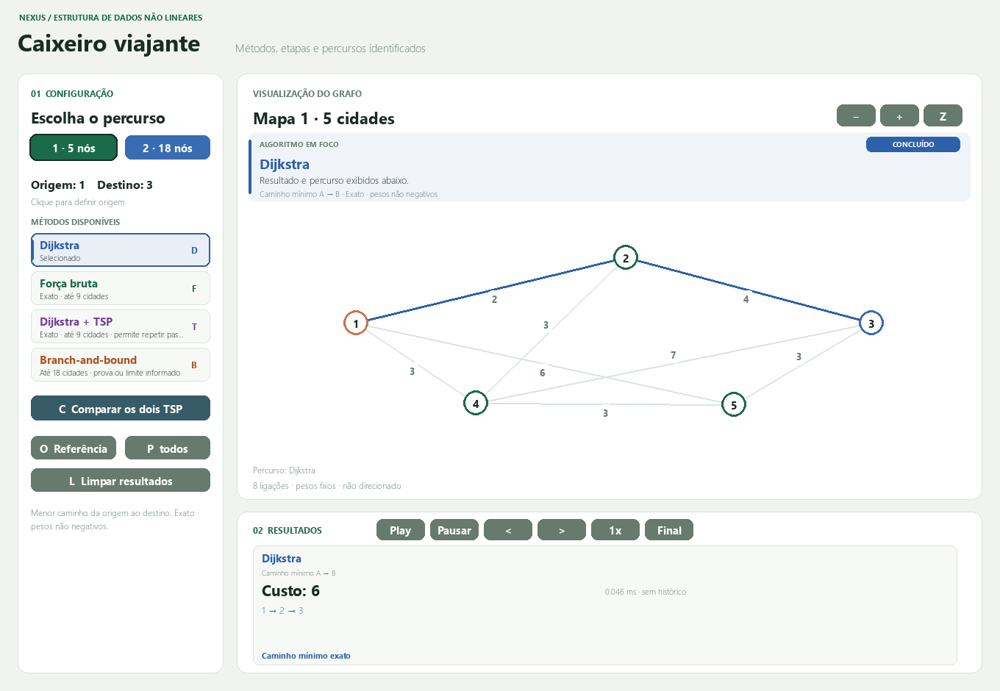
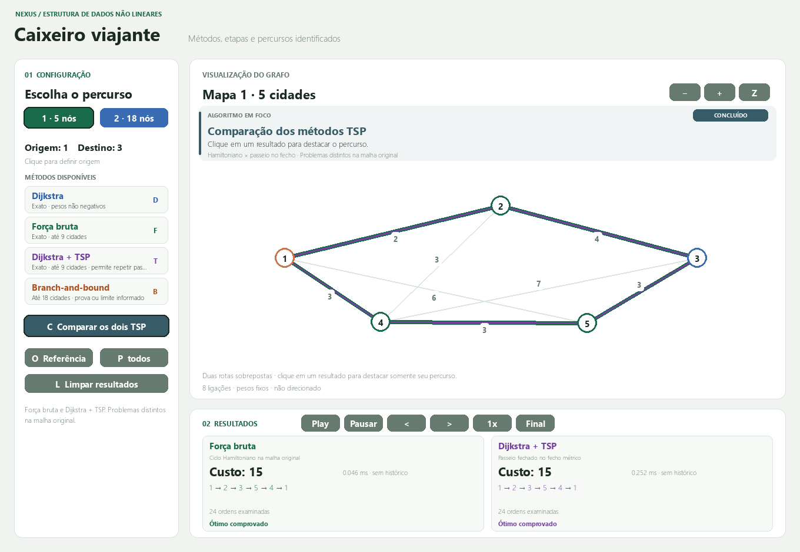
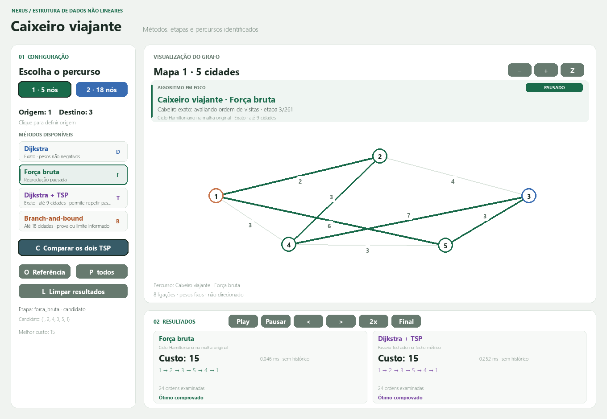
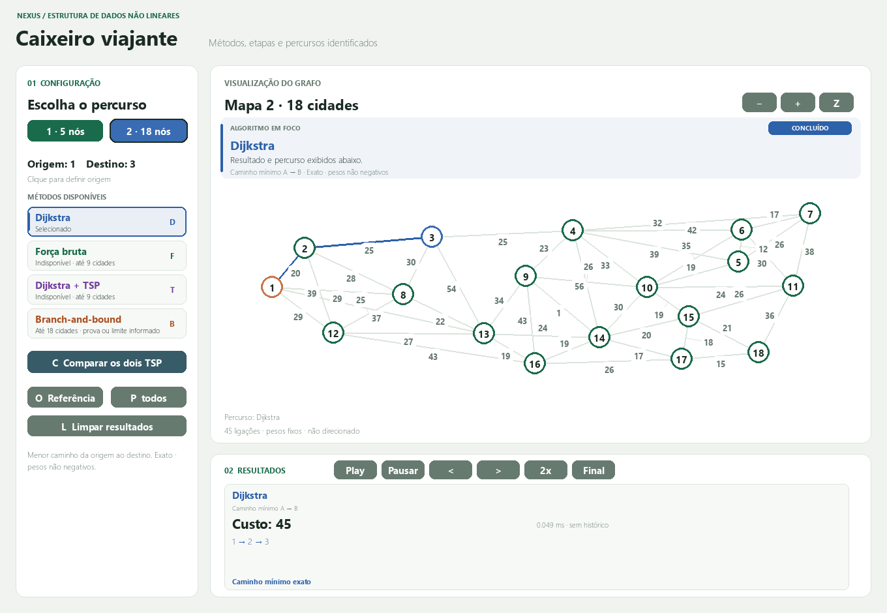
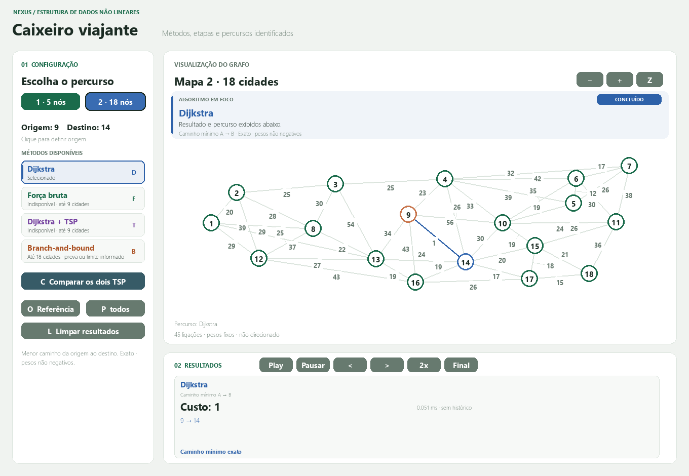
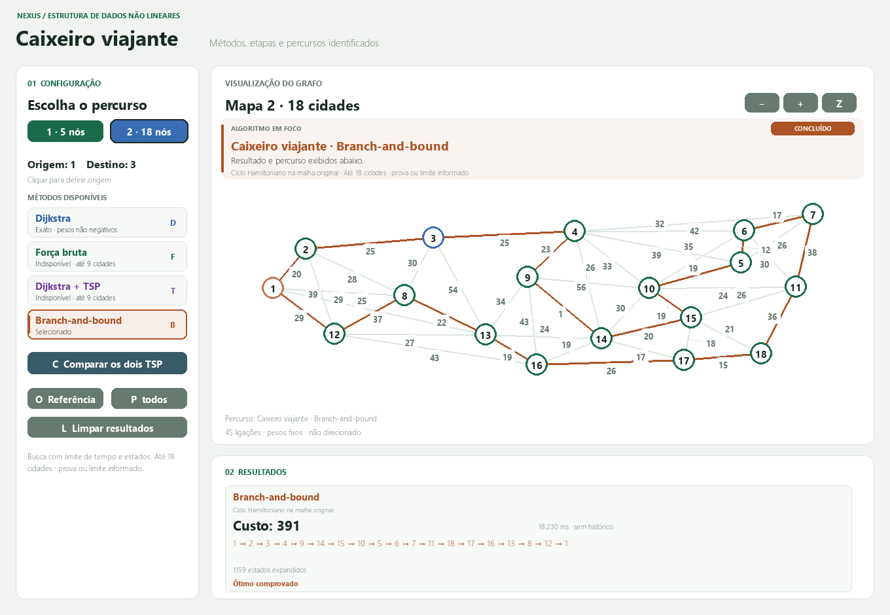
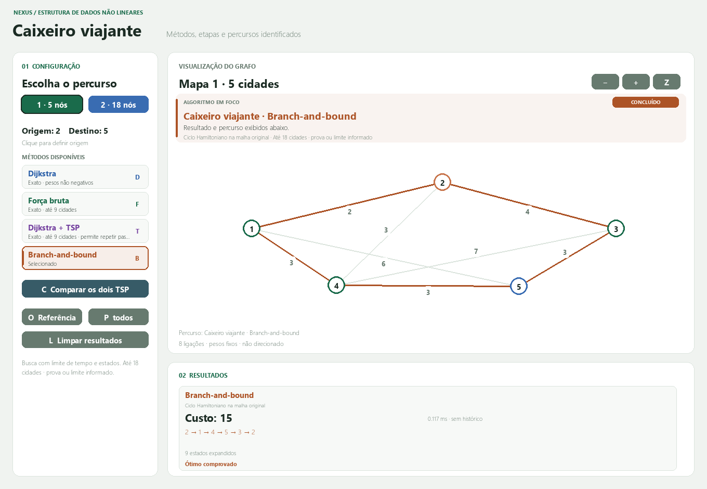

# NEXUS TSP 2D — Relatório e demonstração

## Objetivo e dados

Representar os dois grafos fixos da aula de Estrutura de Dados Não Linear em Python/Pygame, preservando IDs, ligações e pesos. Estudar caminho mínimo A→B, ciclo Hamiltoniano mínimo e passeio fechado que cobre todas as cidades. A apresentação é separada do núcleo para permitir evolução futura sem redefinir as instâncias.

As capturas recebidas estão em `assets/referencias/mapa_05_original.png` e `mapa_18_original.png`; os materiais da aula estão em `docs/ativ/`. A auditoria utilizou também as figuras de maior resolução de [Dhiego Pardini, O Problema do Caixeiro Viajante](https://otimizacaonapratica.wordpress.com/2015/11/09/o-problema-do-caixeiro-viajante/). Cópias, hashes, tabela e pendências: [auditoria_mapa_18.md](auditoria_mapa_18.md).

O mapa 5 tem as arestas `1–2:2`, `1–4:3`, `1–5:6`, `2–3:4`, `2–4:3`, `3–4:7`, `3–5:3` e `4–5:3`. Não há ligações diretas 1–3 ou 2–5. O mapa 18 tem 45 ligações e 45 pesos: 44 conferidos nas figuras e **9–14 = 1**, definido posteriormente pelo usuário. A proveniência desse complemento está no JSON; as imagens permanecem preservadas sem alteração. O rótulo 56 pertence a 4–14, e 43 a 9–16. Ambos os mapas estão validados para cálculos.

Coordenadas normalizadas x/y são exclusivamente visuais. Zoom, pan e resize não alteram custos. Cruzamentos não geram vértices. Os grafos são não direcionados; o núcleo aceita pesos não negativos, rejeita valores não finitos/booleanos e não completa arestas ausentes.

## Algoritmos e problemas

| Método | Problema | Garantia/limite |
|---|---|---|
| Dijkstra | Menor caminho da origem ao destino | Exato com pesos não negativos; fila mínima e predecessores |
| Força bruta direta | Ciclo Hamiltoniano mínimo nas arestas existentes | Exato, até 9 nós; origem fixa e retorno |
| Dijkstra + busca exata | Ordem mínima no fecho, expandida em passeio físico | Exato nesse problema, até 9 nós; pode repetir intermediários |
| Branch-and-bound | Mesmo TSP Hamiltoniano da força bruta direta | Até 18 nós, orçamento de 2 s/200 mil estados; distingue prova de corte |

Dijkstra não escolhe sozinho a ordem de todas as visitas. No método composto, ele monta os menores custos entre pares; uma busca TSP escolhe a ordem. Cada trecho é expandido pelos caminhos reconstruídos, evitando apresentar uma aresta inexistente como estrada.

Os dois TSP na malha original têm restrições distintas. No triângulo 1–2=1, 2–3=1, 1–3=10, o Hamiltoniano custa 12, mas o passeio 1–2–3–2–1 custa 4. Numa estrela pode não haver ciclo Hamiltoniano, embora exista passeio fechado que cubra todas as cidades. Esses contraexemplos estão nos testes.

## Complexidade e medição

Com origem fixa, força bruta examina `(n−1)!` ordens e até n ligações por candidato. Para 5 nós são 24 ordens; para 18 seriam `17! = 355687428096000`, razão para recusar esse enumerador nessa escala. O problema TSP de otimização é NP-difícil; a versão de decisão é NP-completa.

Dijkstra com heap tem custo usual `O((V+E) log V)` por busca. Esta implementação didática faz V² chamadas, uma por par, para montar o fecho; depois ainda executa a busca fatorial. Isso não torna TSP polinomial. Branch-and-bound usa árvore geradora mínima residual como limite inferior e cache limitado; o pior caso continua exponencial.

Ordens TSP são permutações completas; nós finalizados em Dijkstra são retiradas definitivas da fila; estados de branch-and-bound são expansões parciais. Tempo é medido sem histórico, e contadores são coletados separadamente. A [comparação formal](comparacao.md) usa mediana de sete execuções, inclui o pipeline composto e traz um controle em que ambos recebem a mesma instância métrica. As medições são desta máquina, não uma garantia universal de velocidade.

## Resultados verificados

| Caso | Resultado |
|---|---|
| Mapa 5, Dijkstra 1→3 | 1–2–3, custo 6 |
| Mapa 5, TSP direto, origem 1 | 1–2–3–5–4–1, custo ótimo 15 |
| Mapa 5, TSP no fecho | Custo 15; soma das arestas físicas preservada |
| Cinco origens do mapa 5 | Custo ótimo 15 em ambos os TSP |
| Anel sintético de 18 nós | Branch-and-bound: custo 18 e prova de ótimo no orçamento de teste |
| Busca cortada | Diferencia solução conhecida, limite sem solução e inexistência comprovada |
| Mapa 18 real, Dijkstra 9→14 | Caminho direto, custo 1 |
| Mapa 18 real, Dijkstra 1→18 | 1–13–14–17–18, custo 93 |
| Mapa 18 real, TSP Hamiltoniano | Custo ótimo **391**, branch-and-bound com 1159 estados |
| Controle independente do ótimo real | Held–Karp confirma **391**, com 153860 estados |

**96 testes automáticos aprovados**, incluindo os 324 pares do mapa 18 contra Floyd–Warshall, ciclo real de custo 391, estados visuais, origem dos snapshots, foco de rota, controles, worker, zoom e eventos SDL. Saída: [validacao_final.txt](validacao_final.txt). O [smoke SDL](smoke_pygame.md) passou em 20 casos, com capturas renderizadas. O controle independente é reproduzido por `python scripts/validar_mapa_18.py`; resultados e tempos em [resultados_mapa_18.json](resultados_mapa_18.json). A inspeção manual nativa ainda está pendente e não foi declarada substituída por esses testes.

## Capturas da versão 2D

### Caminho mínimo

### Comparação dos problemas TSP

### Reprodução de eventos

### Inspeção do mapa grande validado

### Busca com orçamento

## Roteiro de demonstração (cerca de 8 minutos)

1. **Preparação:** instalar requisitos no ambiente virtual e abrir `python main.py`. Explicar que pesos são fixos e independentes dos pixels.
2. **Mapa pequeno:** mostrar 5 cidades e 8 arestas. Alternar a referência com O. Destacar que 1–3 não é uma estrada direta.
3. **Dijkstra:** manter origem 1/destino 3 e clicar D. Ler 1–2–3 e custo 6. Usar Play/Pausar/avançar para observar distâncias e relaxamentos.
4. **Força bruta:** clicar F e apresentar o ciclo 1–2–3–5–4–1 de custo 15. Explicar as 24 ordens e o limite de 9 nós. Mudar a origem pelos cliques e repetir.
5. **Método combinado e comparação:** T executa Dijkstra + TSP isoladamente. A faixa informa método, modelo e etapa. Depois clicar C: ambos custam 15 neste exemplo. Clicar em cada resultado destaca sua rota. Distinguir ordem de entregas e percurso físico, usando o contraexemplo e o controle comum do relatório.
6. **Animação:** testar Play/Pausar, `<`, `>`, velocidade e Final. Mostrar que uma etapa interna de Dijkstra mantém a identificação do método combinado que a produziu. Explicar histórico separado do relógio e cálculo em segundo plano.
7. **Busca limitada:** clicar B no mapa pequeno e ler `otimo_comprovado`. Explicar os outros estados e que corte por tempo não prova ótimo ou inexistência.
8. **Mapa grande:** escolher 2, usar zoom, pan, P e inspeção pelo cursor. Mostrar o peso 1 em 9–14, definido pelo usuário; a referência original continua sem esse rótulo. Selecionar origem 9/destino 14 e clicar D: custo 1. Restaurar a origem 1 e clicar B: ciclo ótimo de custo 391. F/C continuam recusados pelo limite didático de 9 nós.
9. **Encerramento:** mostrar testes, relatório e controle Held–Karp do ótimo real. Distinguir os testes sintéticos dos resultados do mapa da aula. Explicar a inspeção manual nativa ainda pendente e a futura representação 3D sem mudar dados.

## Limitações e aceite restante

- **TSP-004 concluída:** o usuário definiu 9–14 = 1, com origem do dado documentada e cadastro validado.
- **TSP-017:** a ferramenta de controle solicitou confirmação de acesso ao Python e não forneceu captura utilizável da janela. O usuário autorizou em mensagem, mas a confirmação na interface estava pendente na última tentativa. O roteiro de inspeção manual local está documentado no smoke.
- **TSP-020 concluída:** a execução real provou o custo 391 dentro do orçamento e foi conferida independentemente. Em outras instâncias, o orçamento ainda pode encerrar a busca sem prova ou sem rota encontrada.
- Muitos pesos em janela pequena exigem zoom, modo por nó e inspeção por cursor.

O relatório e o roteiro constituem a entrega documental da TSP-021, atualizada com os resultados reais após completar o dado faltante. Permanece pendente o smoke manual nativo; a validação numérica do mapa grande está concluída. As tarefas 3D TSP-022 a TSP-024 não foram iniciadas.
