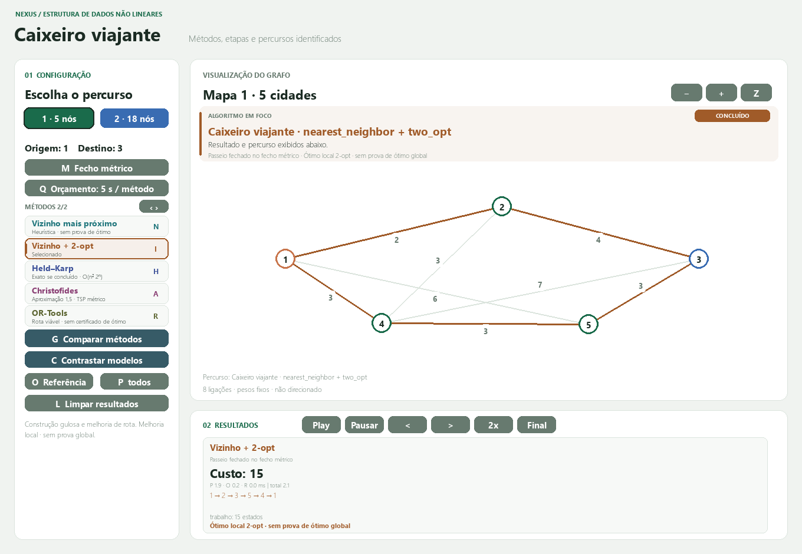
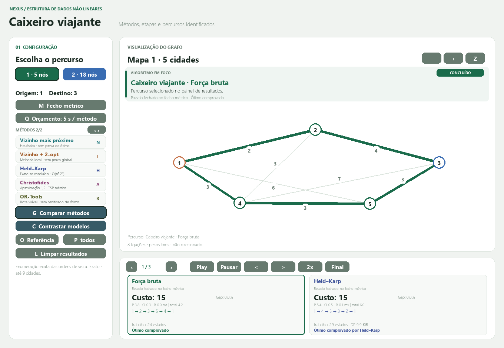
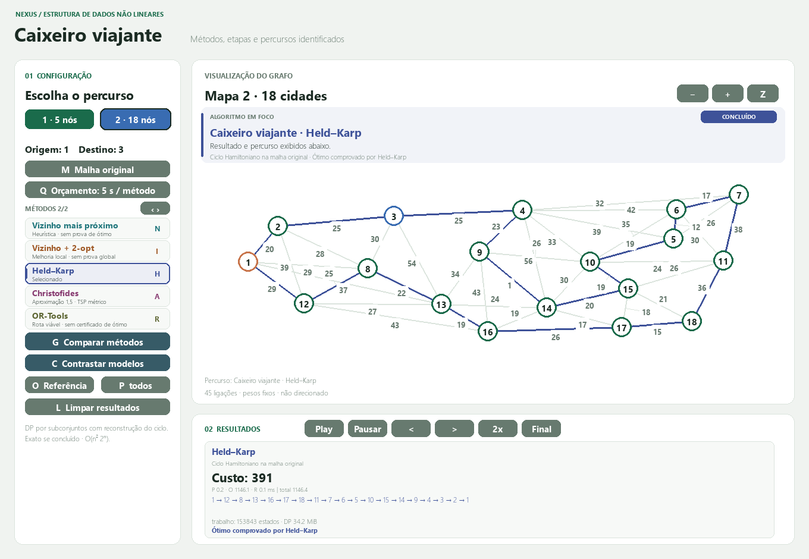
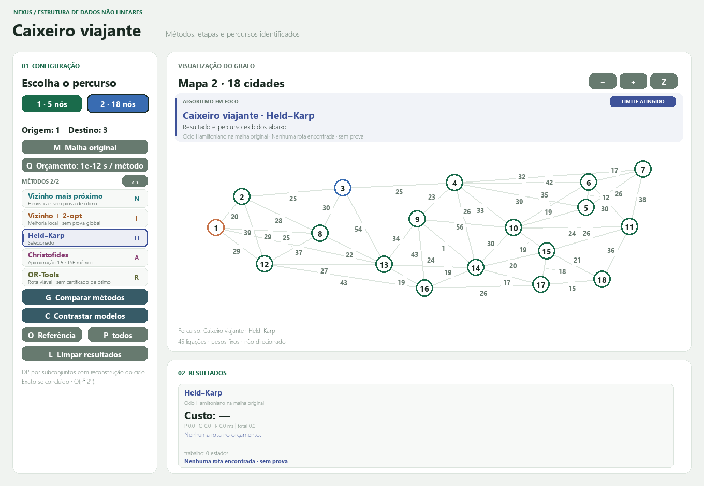

# Integração dos métodos — TSP-032

As TSP-026 a TSP-032 foram implementadas em sequência, com commit individual.
Os cinco solvers estão no registro, no worker e na interface. Nenhum peso ou
JSON foi alterado nesta entrega. A inspeção manual nativa da TSP-017 continua
separada: estas capturas são superfícies renderizadas por SDL.

| Before | After | Why |
|---|---|---|
| Quatro métodos em lista fixa | Duas páginas por botão/Tab | Acomoda os novos métodos também em 1000 × 760 |
| Dois resultados do contraste de modelos | G compara seis métodos; cards paginados | Mantém leitura e agrupa a mesma instância/origem/modelo |
| Tempo único com repetição para histórico | P/O/R e total com snapshots limitados em uma execução | Expõe preparação, otimização e reconstrução |
| Sem comando de interrupção | X/Cancelar e orçamento por Q | Janela continua processando eventos e cortes não viram provas |

## Operação

- Tab/‹ ›: página de métodos; N: vizinho; I: vizinho + 2-opt; H: Held–Karp;
  A: Christofides; R: OR-Tools.
- M: modelo aplicado a N/I/H/R e G. F/B continuam na malha original; T/A
  continuam no fecho. A faixa e cada resultado sempre mostram o modelo efetivo.
- Q: 0,5/2/5/15 s por método. O padrão é 5 s; estados até 2 milhões, memória
  DP até 256 MiB, até 1000 varreduras 2-opt e 3000 snapshots por método.
- G: compara força bruta, Held–Karp, vizinho, 2-opt e OR-Tools, mais
  Christofides no fecho ou branch-and-bound na malha original.
- C: contraste didático dos dois modelos anteriores, explicitamente distintos.
  Esse contraste não calcula gap nem ranking entre problemas diferentes.
- Resultados: ‹/› para páginas, clique para foco de rota, Play para histórico.
  As fases internas de Dijkstra preservam o método que as gerou. As trocas
  2-opt guardam arestas/custos e Christofides expõe suas cinco etapas.

O registro detecta limites e ausência da dependência opcional. Um card
indisponível informa o motivo ao tentar executar, sem iniciar trabalho inválido.
Em G, resultados indisponíveis permanecem explícitos, sem rota ou gap.
Heurística, ótimo local, aproximação, certificado exato, construção bloqueada,
cancelamento e limite mantêm garantias próprias. A faixa usa a garantia efetiva
do resultado, inclusive quando ele é selecionado durante uma comparação.

## Comparação e evidências

Cada resultado tem impressão SHA-256 dos IDs, direções e pesos. O resumo
recusa resultados com instância, modelo ou origem diferentes. Held–Karp é
preferido como oráculo quando conclui; outra busca exata concluída pode fornecer
o certificado. Sem certificado do mesmo grupo, gap fica ausente. Ótimo zero
é tratado sem divisão por zero. Contadores declaram unidades; memória DP é
exibida em MiB e registrada em bytes. Os tempos incluem snapshots limitados.

`scripts/demonstrar_solvers.py` gera [tabelas](comparacao_solvers.md) e
[JSON](comparacao_solvers.json) com rotas físicas, ordem, contadores e parâmetros.
Nessa evidência usa 15 s por método e OR-Tools GREEDY_DESCENT; a UI usa
GUIDED_LOCAL_SEARCH. Tempos observados não são um ranking de desempenho.

No mapa 5/fecho: vizinho 17; 2-opt, Held–Karp, Christofides e OR-Tools 15.
No mapa 18/original: Held–Karp e branch-and-bound certificam **391**.
Na execução registrada do mapa 18/fecho, Held–Karp atingiu limite de tempo;
os passeios 412 (vizinho), 388 (2-opt), 402 (Christofides) e 379 (OR-Tools)
são viáveis, sem ótimo certificado desse grupo, portanto sem gap. Um passeio
menor que 391 no fecho não contradiz o certificado Hamiltoniano original.

Validação: **129 testes** aprovados e **31 casos SDL** aprovados, com OR-Tools
9.15.6755 instalado no Python 3.14. Inclui ausência simulada da dependência,
timeout, cancelamento real, construção bloqueada, limites de memória/tempo,
modelos distintos, cinco métodos por botões/atalhos, paginação e layout mínimo.

