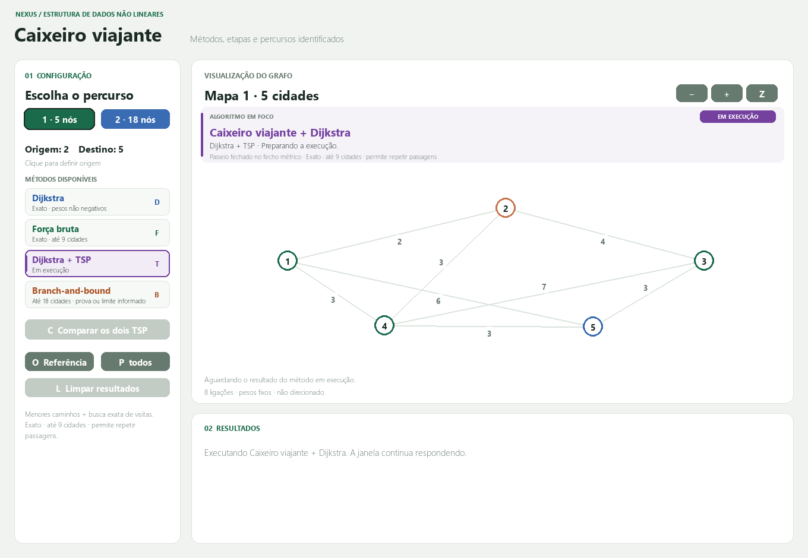
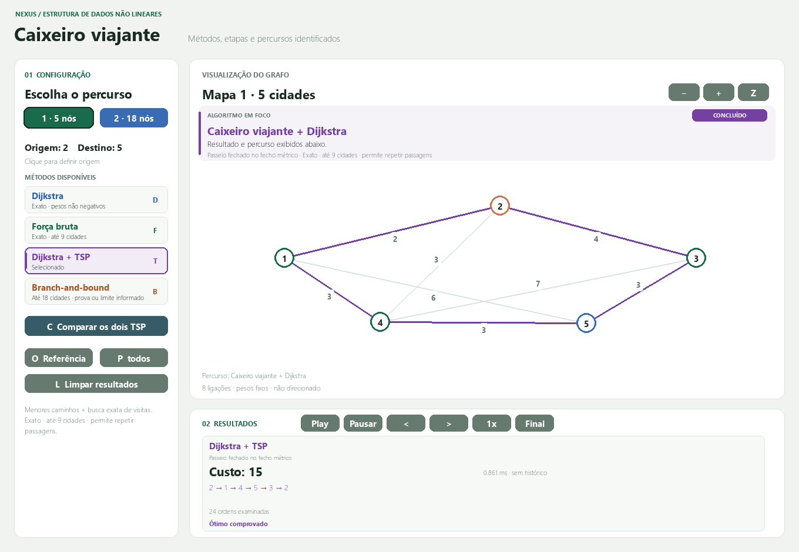
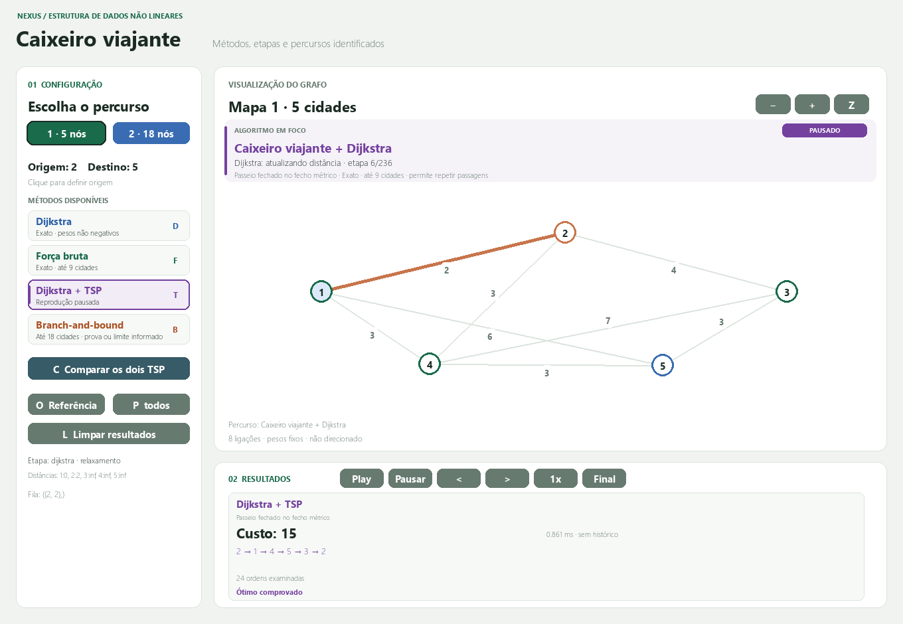
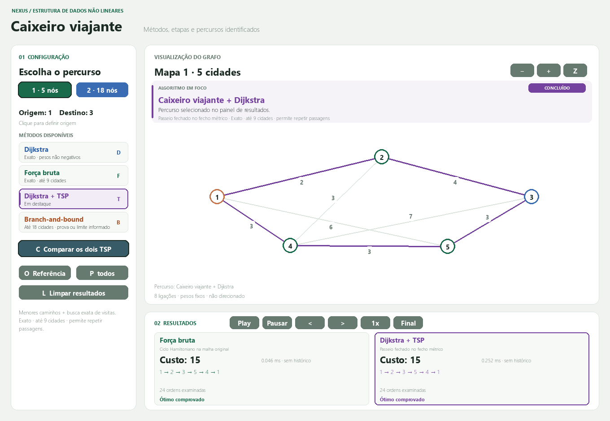

# TSP-025 — Identificação visual dos algoritmos

A interface agora mantém uma faixa **Algoritmo em foco**, com nome do método, modelo do problema, estado e etapa. A identificação não depende apenas de cores. O painel lateral destaca o método e informa quando ele é indisponível para o tamanho do mapa.

| Before | After | Why |
|---|---|---|
| Mensagem genérica de cálculo | Método e etapa informados pelo worker | Saber o que está sendo executado |
| Dijkstra + TSP acessível pela comparação | Card próprio e tecla T | Executar e acompanhar o método composto isoladamente |
| Histórico interno sem origem explícita | Cada snapshot preserva o método que o produziu | Identificar Dijkstra como etapa do pipeline TSP |
| Duas rotas sobrepostas | Clique em cada resultado para focar sua rota | Associar percurso e método sem depender de cor |
| Rótulos técnicos de status | Garantia em linguagem explícita por resultado | Distinguir ótimo, solução conhecida, limite e inexistência |

## Estados visíveis

| Estado | O que significa |
|---|---|
| Pronto | Método selecionado; não há cálculo em andamento |
| Em execução | Worker processa o método indicado; a fase vem de mensagens na fila |
| Concluído | Resultado disponível; a garantia específica fica no card |
| Reproduzindo / Pausado | Histórico de uma execução já concluída, com método de origem e etapa interna |
| Indisponível | Método escolhido não atende ao limite/dado do mapa; não há resultado atribuído a ele |
| Erro | Falha de execução; não é apresentada como solução |

O método **Caixeiro viajante + Dijkstra** identifica três fases reais: calcular caminhos mínimos, buscar a melhor ordem de visitas e expandir o percurso nas arestas originais. A preparação do histórico é indicada separadamente. Não há percentual de progresso fictício para a busca.

Durante a reprodução do fecho, a faixa continua mostrando o método composto mesmo quando o snapshot interno é de Dijkstra. Durante a comparação, o cálculo identifica qual dos dois métodos está sendo processado. O estado "concluído" não significa automaticamente "ótimo": a garantia é exibida em cada resultado.

## Uso

- **T:** executar Dijkstra + TSP sozinho (até 9 cidades).
- **C:** comparar força bruta direta e TSP no fecho. Os modelos permanecem distintos na malha original.
- **Clique em um card de resultado:** destacar apenas aquela rota. Clicar novamente no mesmo card restaura a sobreposição da comparação.
- **Play/Pausar e navegação:** a faixa informa método, etapa interna e posição no histórico.
- **Trocar mapa ou limpar:** remove histórico e resultados antigos; não mantém rótulo de execução concluída para uma seleção nova.

Os métodos futuros não aparecem como se já estivessem disponíveis. O catálogo desta etapa contém apenas os quatro solvers atuais e a ação de comparação. O novo planejamento está em [novos_algoritmos.md](novos_algoritmos.md).

## Verificação

**96 testes aprovados**, incluindo estados do worker, execução isolada do fecho, fases, proveniência dos snapshots, foco de rotas, limites no mapa 18, garantias de buscas cortadas e layout 1000 × 760. O roteiro SDL passou em **20 casos**. Foram revisadas visualmente as capturas renderizadas; isso não encerra a inspeção manual nativa pendente da TSP-017.

