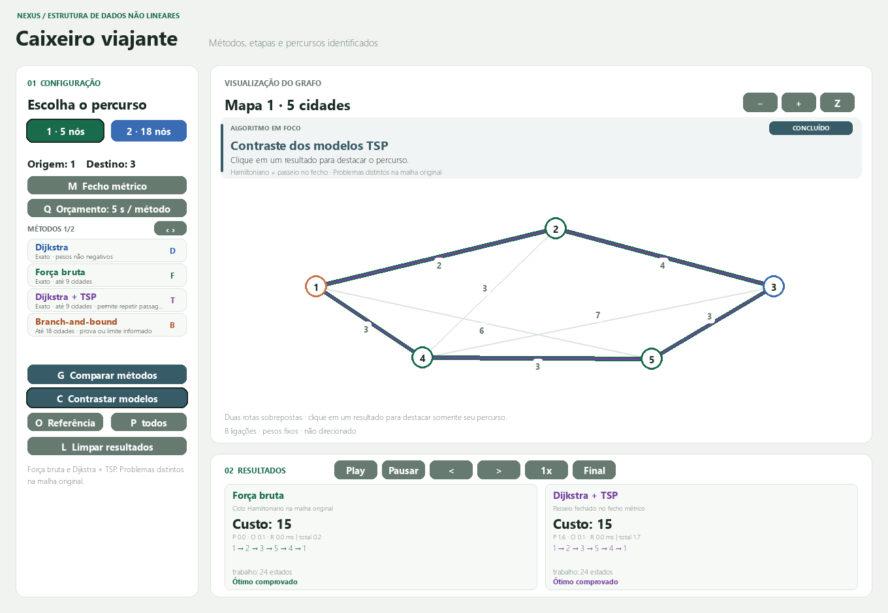
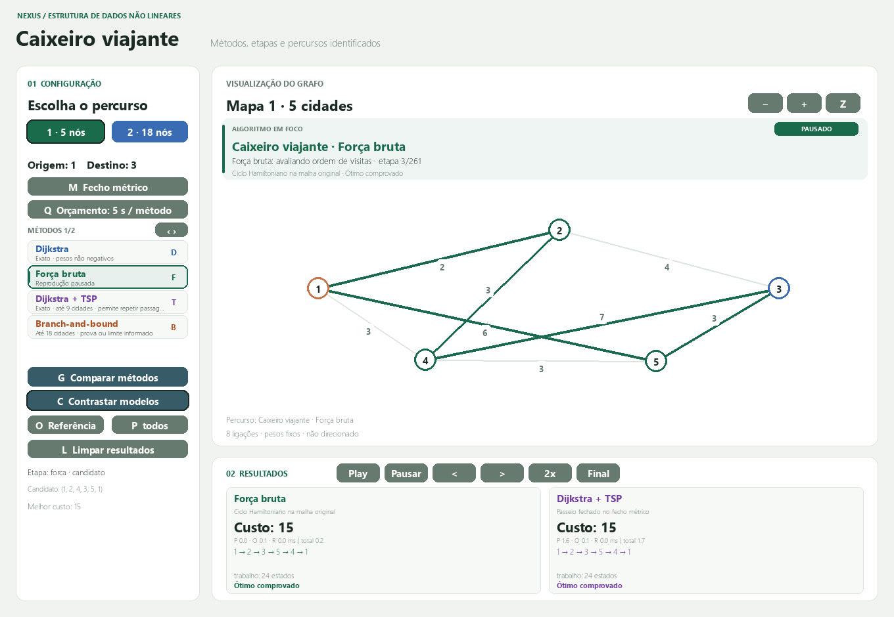
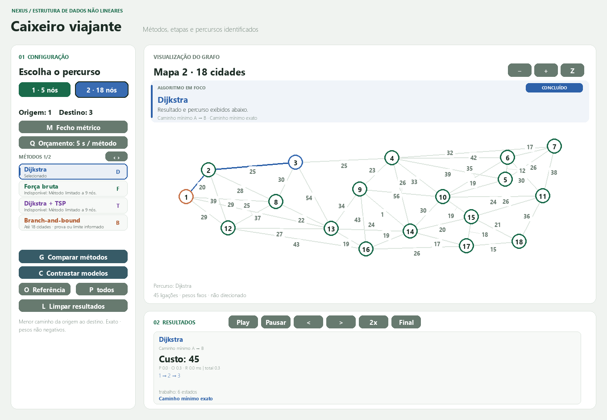
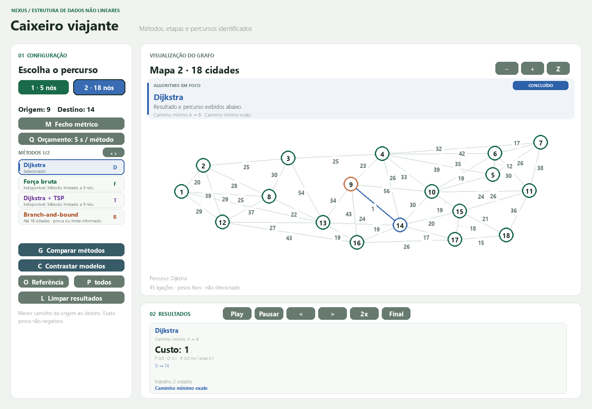
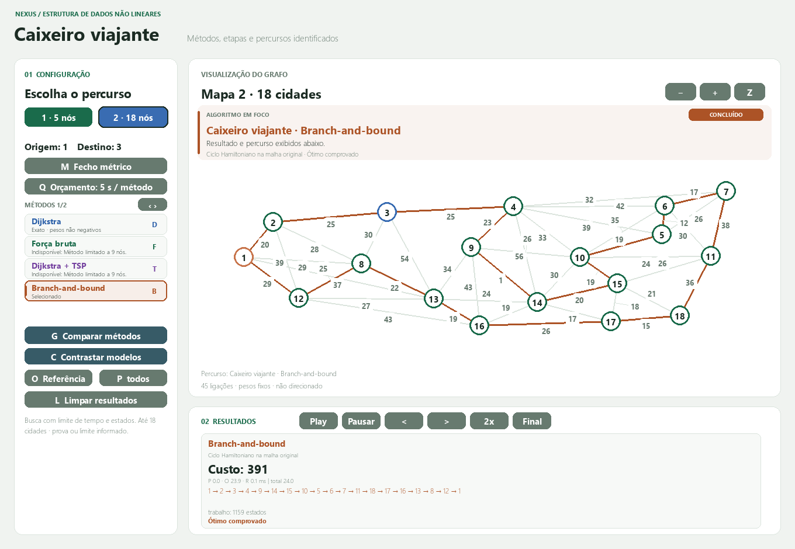

# TSP-017 — Verificação da interface

## Verificação executada

Ambiente: Windows, Python 3.14, pygame-ce 2.5.8 / SDL 2.32.10. Requisitos instalados em `.venv`. Comando reproduzível:

```powershell
.venv\Scripts\python.exe -B scripts\smoke_pygame.py
```

**31 casos passaram**, via eventos Pygame/SDL dummy, incluindo o mapa 18 validado e a identificação visual da TSP-025. O resultado está em [smoke_resultados.json](smoke_resultados.json). As capturas são da superfície renderizada do aplicativo, sem captura de outros programas. Foram inspecionadas as telas de comparação, animação, janela mínima, método composto e foco de resultado. A captura "Em execução" representa o primeiro frame após disparar o worker, antes de receber o resultado, sem atrasos artificiais.

| Caso executado | Resultado |
|---|---|
| Dijkstra pelo botão | Caminho 1–2–3, custo 6 |
| Clique nos nós | Origem 2 e destino 5 selecionados alternadamente |
| Força bruta pelo botão | Custo 15 |
| Primeiro frame de execução | Faixa identifica Dijkstra + TSP e o estado Em execução |
| Método composto pela tecla T | Executa sozinho e retorna custo 15 |
| Reprodução interna de Dijkstra | Mantém o método de origem Dijkstra + TSP na faixa |
| Busca limitada pelo botão B | Custo 15, ótimo comprovado no mapa 5 |
| Comparação pela tecla C | Dois TSP com custo 15 |
| Clique no resultado do fecho | Destaca somente a rota de Dijkstra + TSP |
| Clique no resultado direto | Destaca somente a rota de força bruta; novo clique restaura ambas |
| Play, pausar, avançar, voltar, velocidade e final | Índice do histórico muda e pausa; retorno ao resultado final |
| Referência do mapa 5 | Imagem original carregada |
| Mapa 18, Dijkstra 1→3 | Custo 45 |
| Mapa 18, Dijkstra 9→14 | Caminho direto, custo 1 |
| Mapa 18, busca limitada B | Ciclo de custo 391, ótimo comprovado |
| Mapa 18, força bruta/comparação didática | Recusados pelo limite de 9 nós; mensagem visível mesmo após cálculo bem-sucedido |
| Zoom, pan e Z | Transformação visual e reset sem alterar custos |
| Referência do mapa 18 | Imagem original carregada |
| Redimensionamento | Renderização em 1000 × 760 |
| N/I/H/A/R | Novos métodos no fecho: 17/15/15/15/15 no mapa 5 |
| G e páginas de resultados | Seis métodos no mesmo modelo; oráculo 15, gap válido |
| H no mapa 18 original | Ciclo reconstruído de custo 391 e memória registrada |
| Orçamento esgotado | Estado Limite atingido, sem certificado |
| X/Cancelar | Cancelamento cooperativo no worker |
| OR-Tools ausente (simulado) | Indisponibilidade, sem travar os demais métodos |
| Mapa pendente em memória | Novos cálculos bloqueados; JSON real preservado |
| Escape | Loop encerrado |

## Inspeção manual nativa ainda pendente

A janela nativa foi iniciada fora do sandbox. A ferramenta de controle do computador solicitou autorização para o aplicativo Python, mas as tentativas de captura retornaram a interface de aprovação, não uma captura utilizável da janela Pygame. O usuário autorizou o acesso em mensagem; a confirmação na interface da ferramenta ainda estava pendente na última tentativa. Nenhuma interação foi enviada à interface de aprovação.

Assim, **TSP-017 permanece aberta**: os testes SDL e as imagens renderizadas não são registrados como cliques físicos ou validação manual completa da janela nativa. A habilidade computer-use proíbe automatizar a própria interface do Codex (“Do not automate the ChatGPT desktop app UI or Codex CLI”).

Para completar o aceite local, abrir `python main.py` e repetir a tabela acima com mouse e teclado físicos. Conferir ainda:

- [ ] Roda do mouse sobre o mapa mantém o ponto de zoom sob o cursor.
- [ ] Arraste com botão direito ou do meio move somente o desenho.
- [ ] Modo de pesos por nó permite inspecionar os rótulos do mapa 18.
- [ ] A animação continua responsiva durante resize e alternância de mapas.
- [ ] Não há cortes em textos nos tamanhos de janela usados no computador da apresentação.

Também é possível acompanhar a execução automatizada em janela com `python scripts/smoke_pygame.py --janela`; isso continua sendo teste automatizado, não substitui essa checagem manual.

## Capturas de renderização






