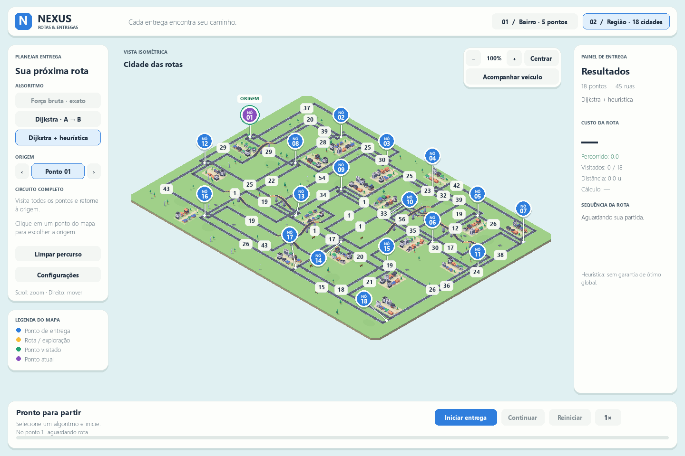
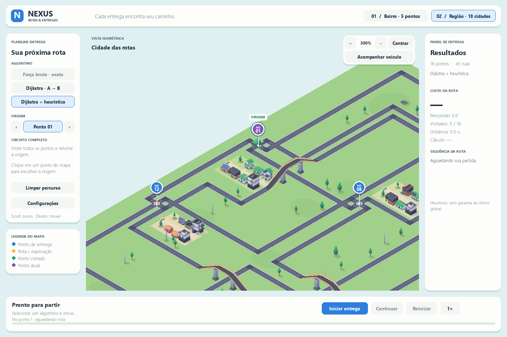
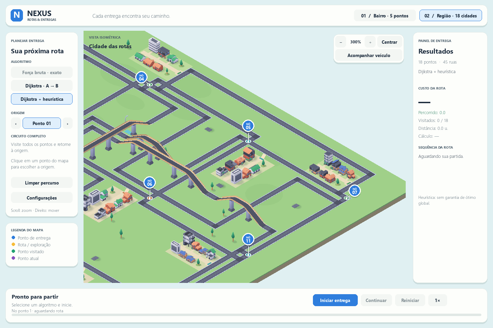
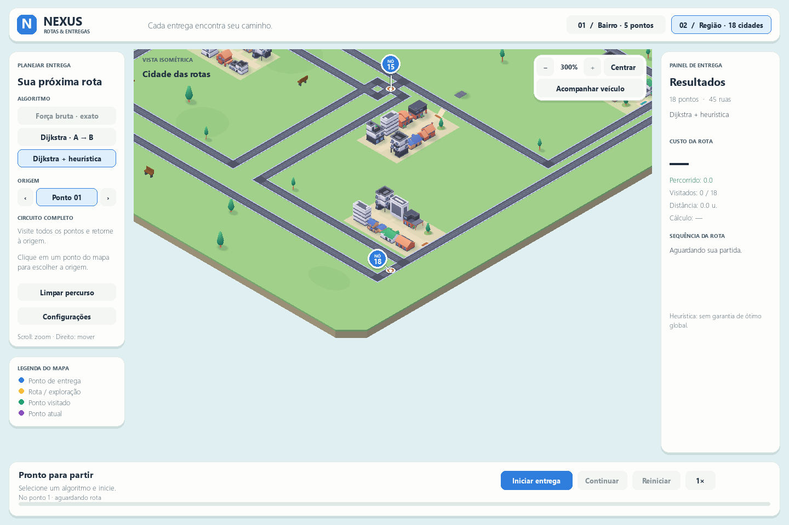

# As 18 cidades do NEXUS 3D

Cada ponto da região tem um lote urbano próprio, com duas fileiras de construções voltadas para uma alameda de pedestres. Os perfis residencial, misto e comercial variam a proporção de casas, prédios baixos e jardins. São **87 casas, 35 prédios e 22 árvores nos lotes**. A ilha continua com 98,1 × 71,1 unidades.

Uma pequena praça liga a alameda ao meio-fio de uma rua que atende a cidade. O marcador `NÓ 01` a `NÓ 18` aponta para a âncora viária onde a van chega. A cor da soleira combina com a marca pintada na âncora. As alamedas e calçadas são parte da cena estática.

O gerador usa uma semente fixa por cidade e só aceita lotes livres de vias, passagens elevadas, água e lotes vizinhos. As casas e prédios usam modelos existentes dos kits Suburban e Commercial. Os jardins usam as árvores locais dos kits, com estas referências de estilo. [Mini Forest](https://kenney.nl/assets/mini-forest) · [Nature Kit](https://kenney.nl/assets/nature-kit)

## Capturas

### Região de 18 cidades

### Nó 01 · residencial

### Nó 05 · misto

### Nó 18 · comercial

## Grafo e testes

- `python -m unittest discover -s tests -q` passou com **104 testes**. A suíte verifica as 18 cidades, os lotes sem sobreposição, os acessos junto às vias, a conservação da topologia e o funcionamento do jogo.
- `python scripts/smoke_3d.py` verifica os mapas em 1440 × 960 e 1100 × 760. Confere os 18 marcadores e os 45 pesos a 65% e a 100%, o detalhe dos três perfis a 300%, a seleção pelo mapa e a viagem completa com câmera em acompanhamento a 4×.
- A comparação com `c27149a` confirmou que os arquivos do grafo, dos algoritmos e das polilinhas permaneceram idênticos. A região tem **18 nós, 45 arestas e 13 passagens elevadas**. Dijkstra de 14 para 9 dá custo **1**, e o circuito heurístico iniciado no nó 1 dá custo **340** e visita as 18 cidades.
- As quatro capturas são geradas pelo smoke em `tmp/3d-review/`. O modo `--janela` passou na abertura, no redimensionamento e no fechamento da janela nativa.

## Desempenho

Os modelos e texturas continuam compartilhados pelo cache de assets, e a cena consolida suas malhas estáticas antes do primeiro quadro. O HUD guarda amostras das ruas e reutiliza a projeção dos prédios e a disposição dos pesos quando a câmera e as etiquetas permitem.

Medianas de atualização do HUD e renderização OpenGL fora da tela, medidas neste ambiente. O teste de arraste usa zoom de 150%.

| Resolução | Antes, câmera parada | Depois, câmera parada | Depois, em arraste |
| --- | ---: | ---: | ---: |
| 1440 × 960 | 70,57 ms | 26,32 ms | 34,05 ms |
| 1100 × 760 | 84,37 ms | 17,92 ms | 26,46 ms |

## Arquivos alterados

| Arquivo | Alteração |
| --- | --- |
| `cidades3d.py` | Planejamento das áreas e acessos, perfis e geração determinística das construções. |
| `render3d.py` | Lotes, praças, alamedas, arborização e integração com o cenário. |
| `hud.py`, `camera3d.py` | Marcadores numerados, afastamento dos telhados e reutilização do cálculo de projeção. |
| `tests/test_render3d.py` | Testes dos lotes, dos acessos, da densidade e da posição das construções. |
| `scripts/smoke_3d.py` | Verificação em zoom afastado e aproximado, capturas e medição durante o arraste. |
| `README.md`, `docs/18-cidades/` | Documentação, relatório e capturas. |
