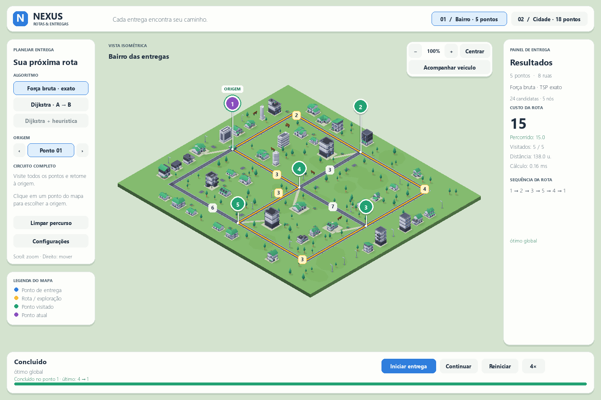
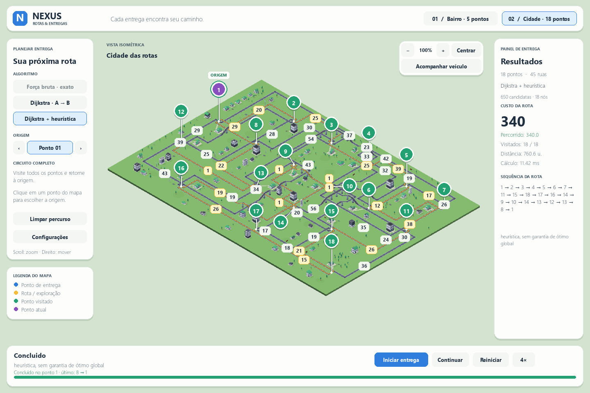
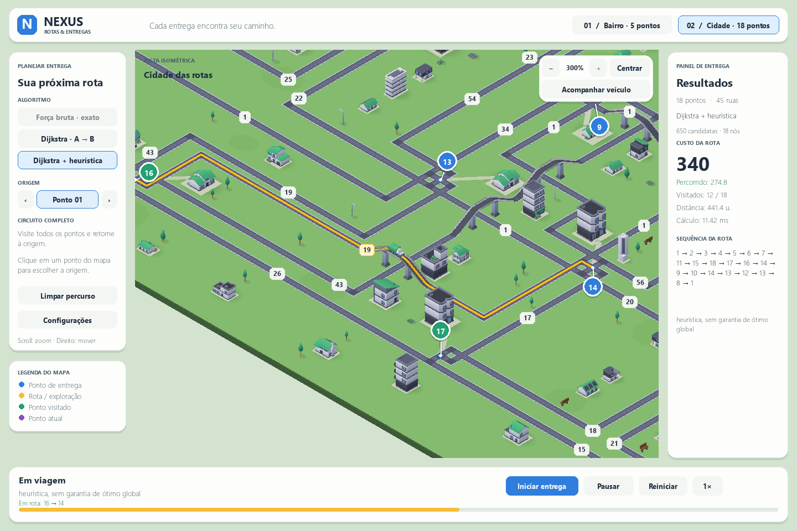

# Refinamento visual do cenário NEXUS

A cidade de 18 nós passou de 137,1 × 95,1 para 122,1 × 86,1 unidades de
terreno, uma redução de cerca de 19%. A malha escolhida tem 21 unidades
entre pontos vizinhos da grade, ante 24. Um ensaio a 18 unidades reduziu
o vão em um cruzamento e foi descartado. A configuração final mantém 17
pontes e 1,65 unidade de diferença de cota nos cruzamentos verificados.

| Cenário | Nós | Ruas | Edifícios antes → depois | Árvores | Jardins | Custo do circuito |
| --- | ---: | ---: | ---: | ---: | ---: | ---: |
| Bairro | 5 | 8 | 33 → 43 | 100 | 12 | 15 |
| Cidade | 18 | 45 | 46 → 70 | 126 | 12 | 340 |

Cada mapa ganhou 14 postes, 6 bancos e 8 passeios de pedra. Os edifícios
decorativos seguem fileiras próximas às vias e têm altura limitada a 3,2
unidades. O pavimento elevado conserva a largura das ruas e segue a mesma
polilinha usada pela van e pelo realce de percurso. As rampas têm inclinação
atenuada nas duas extremidades. A cidade ganhou um canal curto sob um trecho
elevado, ao lado da pista inferior. A configuração anterior tinha cruzamentos
viários elevados e terreno seco.

## Assets

| Kit local | Uso |
| --- | --- |
| City Kit Roads | Asfalto e textura de `road-straight`, junções `road-crossroad`, apoios `bridge-pillar-wide` e postes `light-curved` e `light-square`. |
| City Kit Commercial | Prédios `building-*` e `low-detail-building-*` nas quadras. |
| City Kit Suburban | Casas `building-type-*`, árvores `tree-small` e `tree-large`, arbustos `planter` e passeios `path-stones-short`. |
| Car Kit | Van `delivery`. |

As laterais das pontes, a água e os bancos são gerados pela cena. As
referências [Mini Forest](https://kenney.nl/assets/mini-forest) e
[Nature Kit](https://kenney.nl/assets/nature-kit) orientaram o estilo.
Os modelos efetivamente usados vieram dos kits instalados em `assets/`.

## Validação

- `python -m unittest discover -q` passou com **102 testes** em 69,697 s.
- `python scripts/smoke_3d.py` passou em **1100×760 e 1440×960**. Conferiu
  as âncoras, os pesos, as paradas, a geometria da rota e a visibilidade
  da van em 469 e 536 quadros por resolução, a 4× e zoom de 300%.
- A captura elevada confirmou a posição da van na cota do tabuleiro no
  trecho 16 → 14. As capturas foram comparadas com as da entrega anterior.
  Os lotes foram ocupados com mais variedade e as vias mantiveram a leitura
  isométrica. No mapa maior, o zoom facilita ver mobiliário e fachadas.
- Os arquivos `data/`, `tsp_core.py` e `solvers.py` estão idênticos à base
  `15269c0`. Os circuitos mantiveram os custos 15 e 340, e Dijkstra de 14
  para 9 manteve custo 1.

## Capturas

## Commits e arquivos

| Task | Commit | Arquivos |
| --- | --- | --- |
| 01 · Pavimento e canal | `04cff60` | `render3d.py`, `tests/test_render3d.py` |
| 02 · Compactação | `aaf1226` | `roteamento3d.py` |
| 03 · Quarteirões | `2e35d3d` | `render3d.py`, `tests/test_render3d.py` |
| 04 · Edifícios | `c41d1e5` | `render3d.py`, `tests/test_render3d.py` |
| 05 · Vegetação | `9044570` | `render3d.py`, `tests/test_render3d.py` |
| 06 · Mobiliário | `c31c491` | `render3d.py`, `tests/test_render3d.py` |
| 07 · Escala e rampas | `b21e5d5` | `render3d.py`, `roteamento3d.py` |
| 08 · Validação | Este commit | `scripts/smoke_3d.py`, relatório e três capturas |
