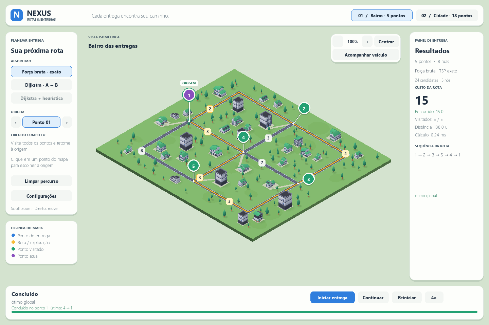
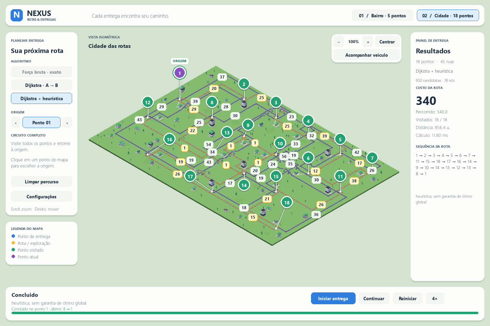
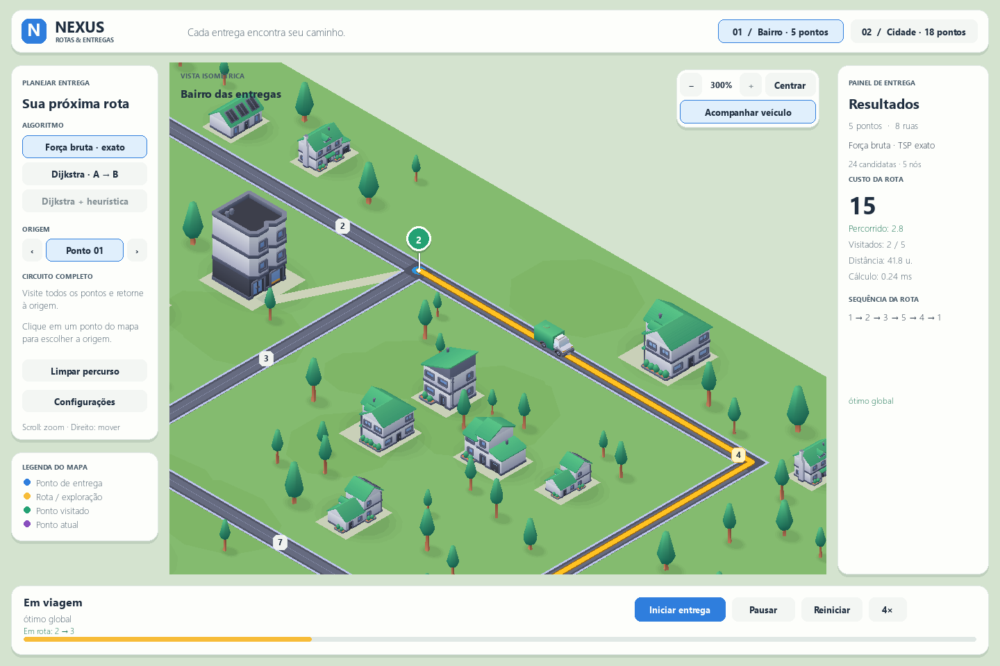

# Validação complementar do posicionamento e da câmera

O ponto de entrega de cada nó é a mesma âncora usada pelas ruas, pela parada
da van e pela haste do marcador. Uma calçada liga essa âncora à fachada. O
bairro tem mais espaço entre os nós 1, 4 e 5. A cidade redistribui os nós 5 e
6 e usa 17 pontes, com os apoios fora das pistas inferiores.

O HUD oferece zoom de 65% a 300% por botões ou roda do mouse. O botão
**Centrar** restaura o enquadramento completo a 100%. **Acompanhar veículo**
segue a van com o zoom escolhido. Pausar mantém a câmera na posição, retomar
continua o acompanhamento e o reinício leva a câmera de volta à origem.
Arrastar com o botão direito desliga o acompanhamento.

## Resultados

| Mapa | Nós | Ruas e pesos visíveis no enquadramento inicial | Custo do circuito, origem 1 | Quadros acompanhados por resolução |
| --- | ---: | ---: | ---: | ---: |
| Bairro | 5 | 8 | 15, ótimo global | 469 |
| Cidade | 18 | 45 | 340, heurística | 536 |

A suíte completa passou em **97 testes** em 68,815 s. O smoke executou o jogo
com Panda3D e Pygame em 1440×960 e 1100×760. Conferiu seleção por clique,
pesos, marcadores, zoom, roda do mouse, centralização, pausa, retomada e reinício.
Em cada resolução, percorreu os dois circuitos a 4× com zoom de 300%. Em todos
os quadros amostrados, a posição da van coincidiu com a polilinha da rua, e
a van ficou no enquadramento. Todas as paradas intermediárias coincidiram com
as âncoras esperadas.

O smoke também cobriu a retomada antes de a câmera terminar de voltar à
origem. A retomada encerra esse reenquadramento, e a câmera permanece
parada ao concluir a entrega. Os dados dos grafos e os algoritmos são
idênticos aos da base `2dc3f30`. Dijkstra entre 14 e 9 manteve o custo 1.

```powershell
.\.venv\Scripts\python.exe -m unittest discover -v
.\.venv\Scripts\python.exe scripts\smoke_3d.py
```

No mapa maior, algumas conexões e fachadas ficam mais fáceis de ver com zoom.
A busca de posições livres para as etiquetas tem custo de processamento. No
smoke, a mediana de redesenho do HUD mais renderização no mapa maior foi de
46,37 ms em 1440×960 e 47,84 ms em 1100×760. São medições deste ambiente.

## Capturas







## Registro das etapas

| Task | Commit | Módulos e verificações |
| --- | --- | --- |
| 01 · Referência dos nós | `c2bd02f` | `geometria3d.py`, `render3d.py`, `hud.py`, testes de layout, cena e HUD. 83 testes e smoke. |
| 02 · Distribuição | `4ed469b` | `geometria3d.py`, `roteamento3d.py`, teste de enquadramento da cena. 83 testes e capturas nas duas resoluções. |
| 03 · Junções e pontes | `1eae6bb` | `assets3d.py`, `render3d.py`, testes de assets e cena. 33 testes focais e inspeção da pista inferior. |
| 04 · Fachadas e acessos | `5da2756` | `geometria3d.py`, `render3d.py`, `hud.py`, testes de layout e HUD. Testes focais e revisão dos dois mapas. |
| 05 · Geometria da viagem | `1283d16` | `geometria3d.py`, `mundo3d.py`, `tsp_3d.py`, `render3d.py`, `hud.py`, testes de viagem, integração e HUD. 42 testes focais, smoke e inspeção do retorno 13–12–13. |
| 06 · Controles de zoom | `a2d8f1f` | `hud.py`, `tsp_3d.py`, testes de HUD. Cliques e roda do mouse nos dois mapas e tamanhos. |
| 07 · Acompanhamento | `0daef58` | `camera3d.py`, `tsp_3d.py`, `hud.py`, testes de câmera e integração. Circuito da cidade completo a 4× e 300% de zoom. |
| 08 · Marcadores e pesos | `f058d97` | `hud.py` e testes de HUD. 17 testes focais e inspeção nos dois mapas e tamanhos. |
| 09 · Validação final | Este commit | `scripts/smoke_3d.py`, `tsp_3d.py`, `README.md` e este relatório com as capturas. 97 testes, smoke e revisão visual. |
