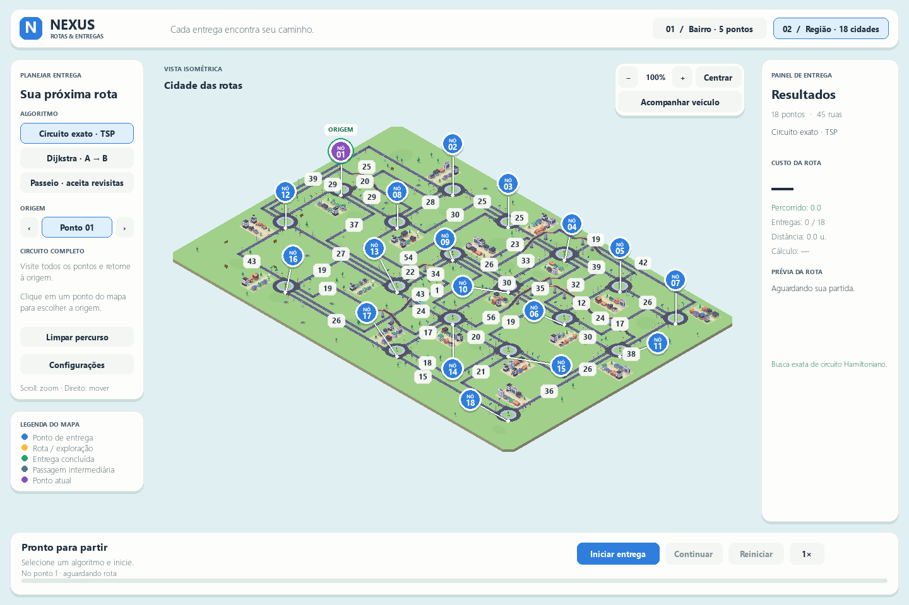
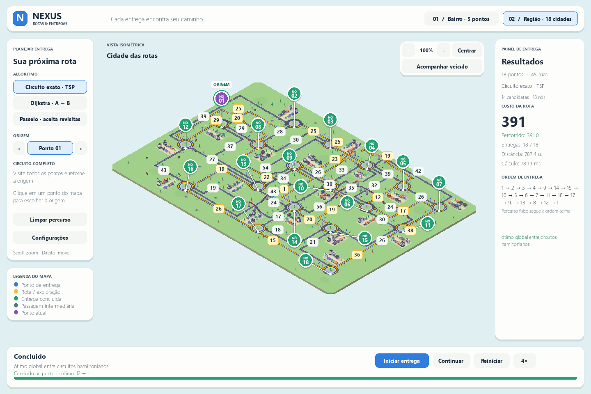

# Validação da rota de 18 cidades

Com origem no ponto 1, o NEXUS 3D calcula o circuito abaixo e conclui a viagem no mesmo ponto, com **18 entregas e custo 391**.

```text
1 → 2 → 3 → 4 → 9 → 14 → 15 → 10 → 5 → 6 → 7 → 11 → 18 → 17 → 16 → 13 → 8 → 12 → 1
```

## Auditoria do grafo

A conferência com `Captura de tela 2026-11-11 135747.png` e com os pesos de `tasks_correcao_sequencia.md` confirmou 18 cidades em um grafo conectado, com 45 ruas em ambos os sentidos. As alterações de transcrição foram estas.

| Cadastro anterior | Referência conferida |
| --- | --- |
| 1–3 com peso 37 | 1–13 com peso 37 |
| 9–10 com peso 1 | 9–10 com peso 26 |
| 10–14 com peso 1 | 10–14 com peso 30 |
| 12–13 com peso 1 | 12–13 com peso 27 |
| 13–14 com peso 1 | 13–14 com peso 24 |

As ruas 9–13 e 9–14 têm pesos 34 e 1, respectivamente. O jogo usa o mesmo grafo para os custos, o roteamento visual, as etiquetas e os algoritmos. O traçado reservou um corredor para a rua 1–13 e ampliou o terreno de 98,1 × 71,1 para 110,1 × 74,1 unidades. A região tem 18 rotatórias e 13 travessias elevadas. [Transcrição completa](../grafos.md) · [Dados do jogo](../../data/mapa_18.json)

## Sequência, expansão e custo

O total de 340 da versão anterior correspondia à soma completa do passeio com os pesos antigos. Recalculado com os pesos corretos, esse mesmo passeio soma 340 até 10 → 14 e mais 129 no restante, totalizando 469. A rota agora usada soma **362** antes do último trecho e **29** no retorno 12 → 1.

O circuito exato procura o menor custo entre as rotas fechadas que usam ruas diretas e visitam cada cidade uma vez. A procura percorre vizinhos em ordem crescente de ID para repetir o mesmo desempate. Uma enumeração independente de percursos diretos confirmou a sequência e o custo. Para cada par consecutivo da referência, Dijkstra também encontra a rua direta como o caminho mínimo.

O modo **Passeio · aceita revisitas** mantém a expansão pelo Dijkstra. Ele encontra um passeio de custo 388 na região com origem 1, passando duas vezes pelo ponto 14. A ordem de entrega registra a ocorrência programada de cada cidade. A van usa todos os trechos físicos, incluindo as passagens intermediárias. Quando as duas sequências diferem, o painel oferece um botão para alternar a visualização.

## Capturas e demonstração





[Vídeo do circuito completo da van, 18,47 s em 4×](capturas/van-circuito-18.mp4)

## Verificação

- `python -m unittest discover -s tests -q` passou com **112 testes**. A suíte cobre as 45 arestas e seus pesos, a simetria da adjacência, a sequência e os 18 trechos do circuito, o retorno à origem, a contagem de entregas, a distinção entre passagem e visita e o custo exibido no painel.
- A checagem do algoritmo encontrou custo 391 nas 18 origens possíveis. Em 120 grafos de 3 a 8 nós gerados com uma semente fixa, o resultado da busca exata coincidiu com o da força bruta.
- `python scripts/smoke_3d.py` conferiu os dois mapas com OpenGL em 1440 × 960 e 1100 × 760. A validação acompanhou 984 quadros da viagem regional em cada resolução, verificou a posição da van nas ruas e confirmou a chegada ao ponto 1. O bairro concluiu com custo 15.
- `python scripts/smoke_3d.py --demo-regiao` grava o circuito, incluindo a chegada e o painel final. O arquivo de 1100 × 760 foi decodificado integralmente e contém 277 quadros.

## Arquivos alterados

| Caminho | Alteração |
| --- | --- |
| `data/mapa_18.json`, `tsp_core.py` | Transcrição corrigida, identificação canônica de ruas e células dos pontos na grade visual. |
| `solvers.py` | Circuito exato, ordem de entrega, índices das ocorrências físicas e soma dos pesos. |
| `geometria3d.py`, `roteamento3d.py` | Traçado das ruas de acordo com as conexões conferidas. |
| `mundo3d.py`, `tsp_3d.py`, `main.py` | Viagem pelo caminho físico, contagem de entregas e acesso ao circuito exato. |
| `hud.py` | Sequências, custo, contagem e estado dos pontos. |
| `tests/test_cenarios.py`, `tests/test_contratos.py`, `tests/test_grafos.py`, `tests/test_hud.py`, `tests/test_integracao.py`, `tests/test_layout_visual.py`, `tests/test_mundo3d.py`, `tests/test_solvers.py` | Regressões do mapa, dos algoritmos, da animação e do HUD. |
| `scripts/smoke_3d.py` | Verificação do jogo em duas resoluções e gravação do circuito. |
| `README.md`, `docs/grafos.md`, `docs/correcao-sequencia/` | Controles, auditoria e evidências da validação. |
