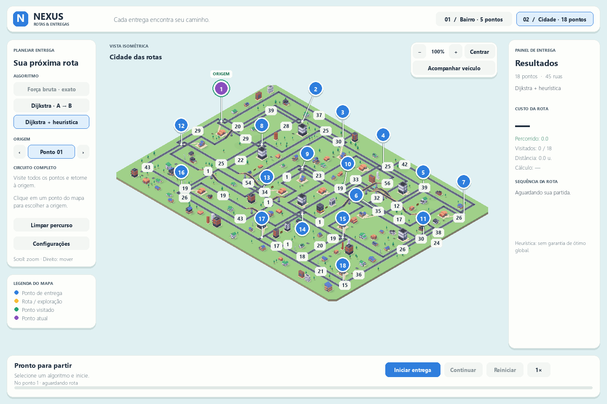
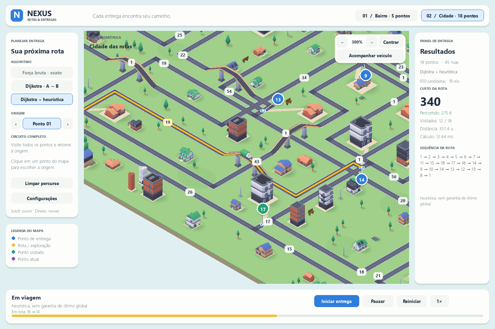
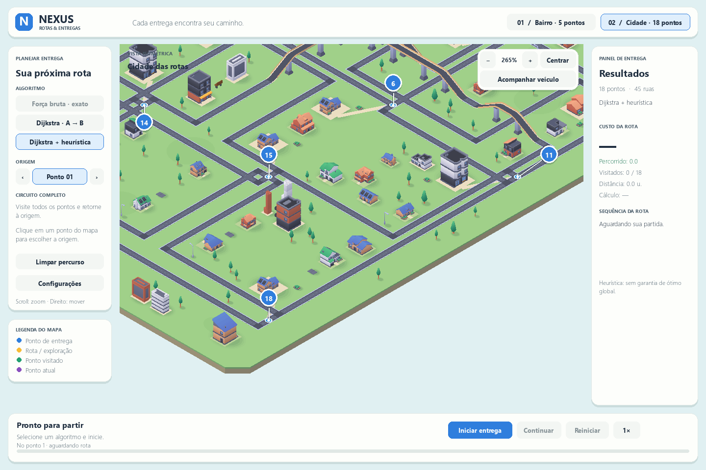

# Refinamento gráfico do NEXUS 3D

A cidade usa uma paleta mais clara, com telhados em verde, azul e terracota, iluminação difusa e sombras de contato graduais. A mesma cor de calçada aparece nos lotes, nos acessos aos pontos e nas bordas das pontes. Os pontos de entrega têm um aro claro sobre a pista. Guarda-corpos em tom de areia e pilares identificam os cruzamentos em níveis diferentes.

## Medidas da cidade

| Medida do mapa de 18 pontos | Antes | Depois |
| --- | ---: | ---: |
| Dimensões da ilha | 122,1 × 86,1 u. | 98,1 × 71,1 u. |
| Espaçamento nominal entre pontos vizinhos da grade | 21 u. | 18 u. |
| Extensão geométrica somada das 45 ruas | 1.872,61 u. | 1.504,21 u. |
| Mudanças de direção no plano, somadas por aresta | 142 | 110 |
| Passagens elevadas | 17 | 13 |
| Casas e prédios, incluindo endereços de entrega | 70 | 98 |

A ilha ocupa cerca de 34% menos área. As saídas centrais das praças permitem que as ruas alinhadas sigam em linha reta. Nos 13 cruzamentos fora das praças compartilhadas, a diferença de cota entre as pistas é de 1,65 u. no centro do cruzamento. O bairro de 5 pontos também ganhou construções, de 43 para 57.

A cidade tem 70 casas e 28 prédios, com fachadas de lojas e edifícios de apartamentos em fileiras voltadas para as ruas. Os lotes decorativos ocupam 48 setores de 10 × 10 u. e foram posicionados com folga para as vias e os demais edifícios. Os prédios decorativos têm até 2,8 u. de altura. Jardins, árvores, bancos e postes ocupam as áreas livres.

## Capturas

### Cidade de 18 pontos

### Ruas e cruzamentos

### Casas e prédios

## Testes executados

- `python -m unittest discover -s tests -q` passou com 103 testes. A suíte verificou a cobertura do pavimento, o vão nas passagens elevadas, a ausência de cruzamentos em nível fora das praças compartilhadas, a ocupação dos lotes e o enquadramento dos dois mapas.
- `python scripts/smoke_3d.py` passou com OpenGL em **1440 × 960** e **1100 × 760**. Conferiu a visibilidade e a ausência de sobreposição das etiquetas no enquadramento inicial, a seleção por clique, os controles de câmera e o retorno físico da van à origem, com acompanhamento a 4× e zoom de 300%. O smoke gera as três capturas em `tmp/3d-review/`.
- No smoke fora da tela, as medianas de atualização do HUD e renderização foram de 51,40 ms em 1440 × 960 e de 54,75 ms em 1100 × 760.
- `python scripts/smoke_3d.py --janela` verificou abertura, redimensionamento e fechamento da janela nativa. O antisserrilhamento de 4 amostras é solicitado na janela nativa. As capturas foram feitas no framebuffer fora da tela.
- Os arquivos `data/`, `tsp_core.py` e `solvers.py` passaram na comparação com a base `b395efd`. A comparação de 372 execuções entre a base e o código atual produziu o mesmo estado de término, caminho e custo em todos os pares de Dijkstra e nos circuitos de todas as origens dos dois mapas. A partir do ponto 1, o circuito de 5 pontos custou **15** e o de 18 pontos custou **340**. Dijkstra de 14 para 9 custou **1**.

## Arquivos modificados

| Arquivo | Alteração |
| --- | --- |
| `roteamento3d.py` | Malha compacta, saídas centrais e priorização de corredores para o traçado visual. |
| `render3d.py` | Paleta do terreno e das vias, marcadores de pista, guarda-corpos, sombras, lotes e distribuição das construções. |
| `assets3d.py` | Reutilização das variações de cor disponíveis nos kits locais. |
| `tsp_3d.py` | Cor de fundo, iluminação e antisserrilhamento da janela nativa. |
| `tests/test_layout_visual.py` | Verificação da compactação, dos cruzamentos e da diferença de cota. |
| `tests/test_render3d.py` | Verificação da densidade, do afastamento e da altura dos edifícios. |
| `scripts/smoke_3d.py` | Capturas reproduzíveis da cidade e das quadras. |
| `README.md` e `docs/refinamento-grafico/` | Relatório e capturas de validação. |
