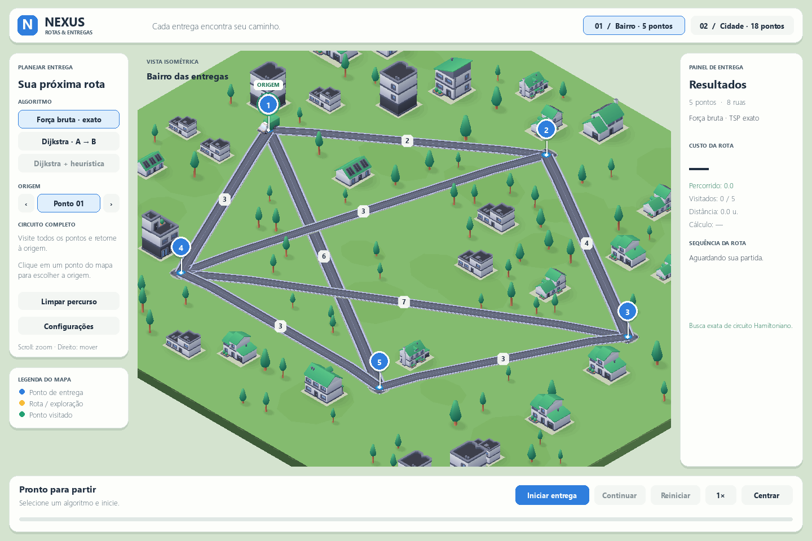
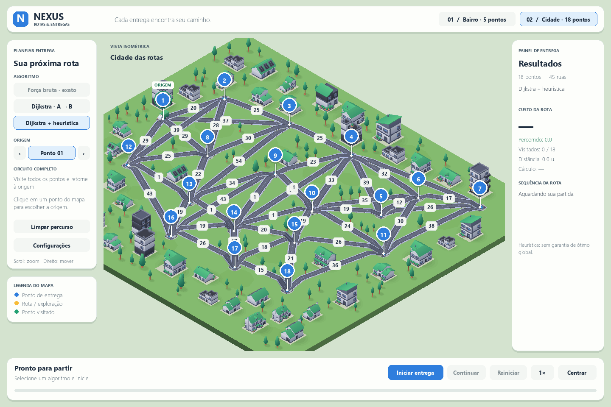

# TASK 01 — Auditoria do refinamento NEXUS

Auditoria de 16/11/2026, sem alteração de código ou dos grafos. A aplicação
existente foi executada nos dois mapas; ambas as capturas foram inspecionadas.

## Arquitetura a preservar

| Responsabilidade | Implementação existente |
| --- | --- |
| Entrada e argumentos | `main.py` |
| Laço, eventos, trabalhador e integração | `tsp_3d.py`, `Aplicacao3D` |
| Renderização 3D | Panda3D; `render3d.py`, `Cena3D` |
| Modelos, materiais e texturas | `assets3d.py`, `Biblioteca`; OBJ/MTL, UVs, colormap e cache |
| Dados e adjacência | `tsp_core.py`, `data/mapa_05.json`, `data/mapa_18.json` |
| Algoritmos | `solvers.py`: força bruta, Dijkstra, vizinho mais próximo e 2-opt |
| Posições, ruas e interpolação | `geometria3d.py` |
| Câmera ortográfica | `camera3d.py`, `CameraIsometrica` |
| Relógio, chegadas, pausa e velocidade | `mundo3d.py`, `Viagem` |
| Painéis, etiquetas e diálogos | `hud.py`, `HUD`, desenhado em Pygame e enviado como textura |
| Verificação | `tests/`, `scripts/smoke_3d.py` |

Os algoritmos consultam exclusivamente a adjacência do grafo. As ruas são
polilinhas por par de nós, com representação inversa para a direção contrária.
O veículo usa as mesmas polilinhas da cena. Esses contratos devem continuar
válidos; não é necessário criar outra aplicação nem trocar o renderizador.

Os dados atuais possuem 5 nós/8 arestas e 18 nós/45 arestas. Permanecem válidas
as correções explícitas anteriores do usuário: **1–3 = 37, 9–13 = 34, 9–14 = 1**.
O realce vermelho 1–13 não introduz uma aresta. Os novos mockups são referências
de estilo e não substituem esses dados, mesmo onde mostram outros números.
As exclusões preexistentes dos dois PNG originais em `ref/` devem ser preservadas
e não incluídas nos commits deste refinamento. O histórico Git permite consultar
as imagens anteriores sem restaurá-las na árvore de trabalho.

## Execução e evidências iniciais

Comandos executados com saída zero:

```powershell
.\.venv\Scripts\python.exe main.py --offscreen --frames 3 --screenshot docs/refinamento/capturas/antes05.png
.\.venv\Scripts\python.exe main.py --offscreen --frames 3 --mapa 18 --screenshot docs/refinamento/capturas/antes18.png
```

Pygame CE 2.5.8, Python 3.14.0 e framebuffer OpenGL real. Houve aviso de
propriedades gráficas disponíveis diferentes das solicitadas, sem impedir a
renderização. Essas execuções comprovam o estado inicial; não validam ainda
o refinamento nem a orientação do veículo em movimento.





Referências visuais inspecionadas:

- `ref/Imagem do ChatGPT 16 de nov. de 2026, 19_13_38.png`: casas com marcadores
  associados, ruas ortogonais, curvas, quarteirões e rota amarela.
- `ref/Imagem do ChatGPT 16 de nov. de 2026, 19_13_48.png`: composição compacta
  do mapa maior, diversidade moderada de construções, verde suave e HUD limpo.

## Diagnóstico da van: frente determinada pela geometria

Asset: `assets/kenney_car-kit/Models/OBJ format/delivery.obj`.
Os grupos nomeados do próprio OBJ fornecem evidência sem depender da posição
atual da câmera:

| Grupo do OBJ | Intervalo longitudinal Z original |
| --- | --- |
| `wheel-front-right`, `wheel-front-left` | 0,71 a 1,31 |
| `wheel-back-right`, `wheel-back-left` | −0,91 a −0,31 |
| `door` (porta traseira de carga) | −1,5914 a −1,5 |

A frente original é **+Z**, com Y vertical. O importador transforma
`(x, y, z)` em `(x, -z, y)`, logo a frente carregada no Panda3D é **−Y**.
`Aplicacao3D._posicionar_carro()` usa `-degrees(atan2(dx, dy))`, orientação
correta para um suporte cuja frente seja **+Y**, mas o modelo não recebe a
correção fixa necessária. Isso explica a aparência de marcha a ré.

Correção planejada para a TASK 07: aplicar **180° de heading no filho que contém
o modelo** uma única vez, fazendo sua frente corresponder a +Y do suporte.
Manter o suporte responsável pelo heading/pitch do percurso; isso também
preserva a inclinação correta em rampas. Não inverter velocidade. Validar
primeiro o asset parado e orientado nas quatro direções, depois o deslocamento
em retas e curvas. A rotação entre trechos deve usar a diferença angular curta
e impedir que a translação corte a esquina enquanto o veículo gira.

## Problemas observados

1. `ruas_mundo()` conecta posições da imagem original por segmentos arbitrários.
   A altura `.24 + indice * .025` apenas separa levemente as arestas: não forma
   pontes reconhecíveis e deixa cruzamentos visualmente confusos.
2. Os segmentos são repetidos até o centro dos nós; a construção das ruas não
   recorta faixas nas junções. Há convergência de várias meshes sobre o mesmo
   espaço e cruzamentos que aparentam conexão sem nó.
3. Os edifícios são adicionados como decoração procurando vagas perto de cada
   ponto. Não existe identidade persistente nó → construção/endereço, e os
   marcadores continuam ancorados no centro da rua. O mapa maior evidencia
   a associação ambígua entre números e edifícios.
4. Os pesos usam sempre o meio da polilinha projetada, sem resolução de
   colisões entre etiquetas, marcadores e edifícios.
5. A orientação da van está invertida pelo eixo frontal; a mudança de heading
   é instantânea. Novas curvas ortogonais tornarão isso mais evidente.
6. A câmera enquadra posições de nós, mas não considera toda a extensão de
   ruas roteadas, pontes e construções. Na captura inicial a ilha e objetos
   decorativos ficam cortados; o novo layout exige novos limites visuais.
7. O HUD já segue grande parte da identidade solicitada. Falta tornar explícito
   o trecho atual na barra inferior e revisar a leitura de rotas/etiquetas após
   a reorganização. Não há razão para substituir os controles funcionais.

## Contratos para orientar a implementação

- Manter `Grafo` e JSON como fonte matemática única. Introduzir no módulo de
  geometria uma representação visual derivada, com posições de nós, lotes e
  referência de asset; nenhuma mudança visual altera adjacência ou pesos.
- Cada aresta conserva identidade e polilinha própria, incluindo curvas e
  eventuais rampas. Renderizador, etiquetas, realce e veículo consultam essa
  mesma geometria; não reconstruir caminhos separadamente em cada componente.
- Roteamento ortogonal deve reservar largura e afastamento, proteger lotes e
  distinguir junções autorizadas de cruzamentos sem conexão. Nós com grau alto
  precisam de uma praça/junção com portas distribuídas; não empilhar ruas no
  mesmo ponto. Quando não for possível evitar um cruzamento, criar uma ponte
  com separação física legível, em vez de incrementos mínimos de altura.
- Recortar o fim dos segmentos junto às junções e tratar curvas explicitamente.
  Testar interseções das áreas ocupadas pelas ruas, não só das linhas centrais.
- O mapa de 18 nós contém o subgrafo completo bipartido K3,3 entre os conjuntos
  `{1, 2, 13}` e `{3, 8, 12}`: as nove conexões existem nos dados confirmados.
  Portanto não é planar; não se pode prometer eliminar todos os cruzamentos
  mantendo a topologia em um único nível. Passagens em níveis diferentes são
  necessárias, com separação vertical e sinalização visual claras.
- Associar cada endereço a exatamente um nó. Reservar espaço para o prédio
  antes de distribuir decoração. Usar esse endereço como âncora do marcador.
- Layout de etiquetas deve reservar caixas de marcadores/painéis e escolher
  trechos adequados da aresta. A posição visual pode variar com a câmera; o
  peso e a identidade da aresta permanecem estáveis.

## Plano de doze etapas e commits

| Task | Alteração e validação principal |
| --- | --- |
| 01 | Esta auditoria, diagnóstico do eixo e duas capturas iniciais |
| 02 | Revalidar transcrição original e correções confirmadas; testes exatos dos grafos |
| 03 | Separar layout visual e endereço dos dados matemáticos; testar invariância dos algoritmos |
| 04 | Rotear ruas ortogonais, junções e pontes; testar afastamentos e inspecionar os dois mapas |
| 05 | Vincular casa/prédio e marcador a cada nó; conferir todos os 5/18 endereços |
| 06 | Organizar etiquetas, aparência das ruas e realce de rota; testar colisões visuais |
| 07 | Corrigir eixo da van e orientar curvas suavemente; testar frente, centro da via e controles |
| 08 | Enquadrar limites completos da cidade; verificar zoom, pan e centralização |
| 09 | Refinar HUD preservando controles e acrescentar trecho atual; conferir resoluções suportadas |
| 10 | Revalidar força bruta, Dijkstra e heurística com dados imutáveis e ruas reais |
| 11 | Executar testes integrados de dados, geometria, veículo, câmera e interface |
| 12 | Capturar ambos os mapas, comparar com referências, verificar curvas e documentar entrega |

Executar na ordem e manter um commit por task, com validações pertinentes antes
de avançar. Nesta TASK 01 foram criados somente este relatório e as duas capturas;
nenhum código, asset, referência ou dado matemático foi modificado.
