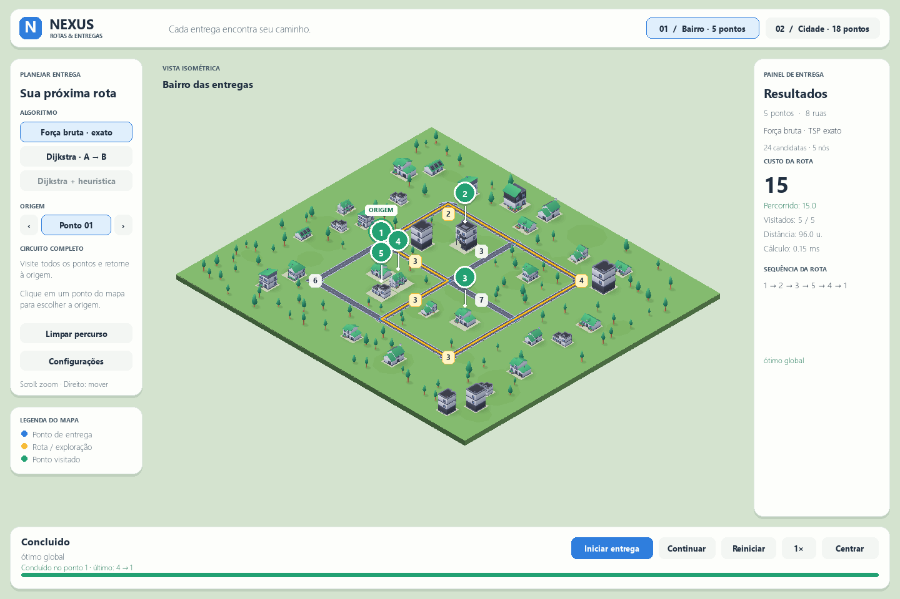
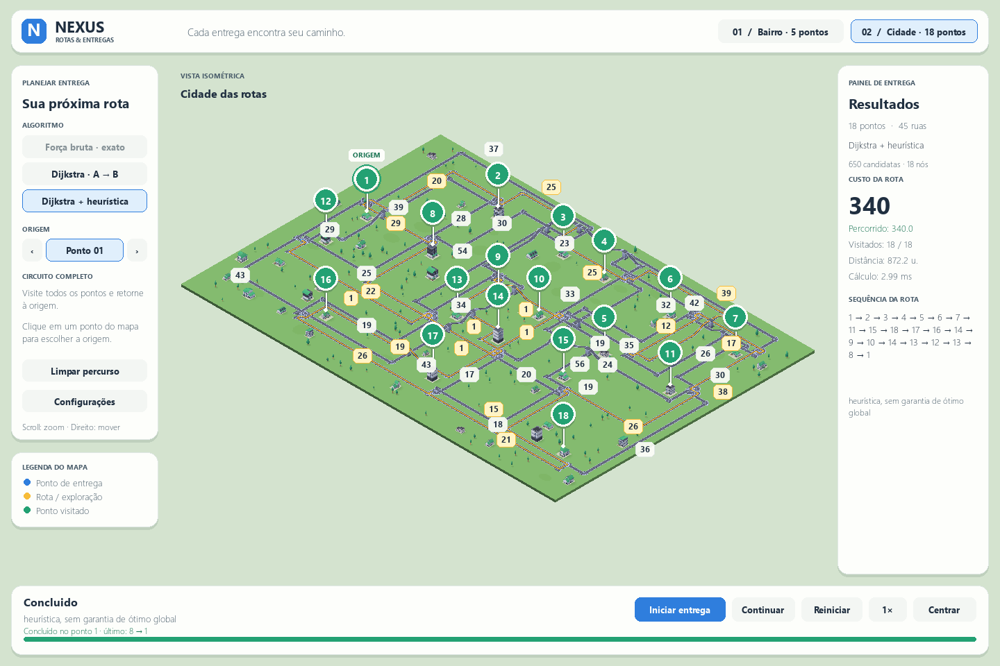
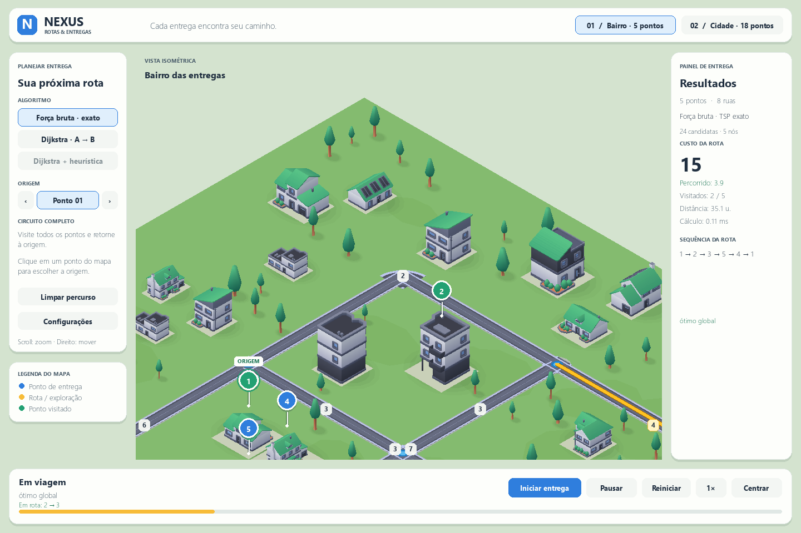

# TASK 12 — comparação visual e entrega

## Resultado

O game existente foi refinado mantendo a renderização Panda3D e a interface
Pygame. O mapa usa ruas ortogonais por aresta, travessias elevadas quando
necessário, construções para cada nó, pins associados aos telhados e etiquetas
de peso legíveis. A rota ativa destaca somente o trecho atual; a van aponta
para o próximo trecho com uma correção fixa do asset e rotação suave. A câmera
inclui a ilha toda no enquadramento inicial e permite zoom, pan e centralização.

Os dados matemáticos permanecem centralizados nos grafos originais. Foram
aplicadas as correções confirmadas pelo usuário: `1–3 = 37`, `9–13 = 34` e
`9–14 = 1`. O circuito exato do mapa de 5 nós custa 15. No mapa de 18 nós,
Dijkstra combinado com vizinho mais próximo e 2-opt encontra um circuito de
custo 340 pelas arestas reais; esse resultado é heurístico e não tem garantia
de ótimo global.

## Capturas finais







As duas capturas dos mapas mostram a cidade completa em 1440×960, com todos os
pins, pesos e o circuito concluído. A terceira é um quadro da viagem no trecho
2 → 3, no cotovelo da rua: a posição continua sobre a polilinha e a van já
antecipa a direção seguinte.

## Assets locais reutilizados

- `assets/kenney_city-kit-commercial_2.1`: prédios urbanos `building-a` a
  `building-h`.
- `assets/kenney_city-kit-suburban_20`: casas `building-type-*` e árvores
  `tree-small` / `tree-large`.
- `assets/kenney_city-kit-roads`: `road-straight`, `road-bend`,
  `road-crossroad`, `road-bridge` e `bridge-pillar-wide`.
- `assets/kenney_car-kit`: modelo `delivery`, com materiais e texturas locais.

## Validação

- `..\venv\Scripts\python.exe -m unittest discover -v`: 82 testes passaram,
  0 falharam, em 48,325 s.
- `..\venv\Scripts\python.exe scripts\smoke_3d.py`: passou nos mapas de 5 e
  18 nós em 1440×960 e 1100×760. Confirmou custos 15 e 340, visita dos nós,
  retorno físico à origem, pausa, velocidades, seleção por clique, diálogos e
  troca/cancelamento durante busca.
- As capturas foram abertas e comparadas visualmente: a ilha, as ruas, as
  construções e as âncoras dos pins cabem no viewport; números e pesos
  permanecem legíveis. A captura aproximada confirma a van sobre a rua durante
  a curva.
- `git diff --check` passou nas alterações das tasks 7–11.

## Arquivos e execução

As mudanças por etapa estão registradas em
[`01-auditoria.md`](01-auditoria.md), [`02-grafos.md`](02-grafos.md),
[`03-modelo-visual.md`](03-modelo-visual.md), [`04-ruas.md`](04-ruas.md),
[`05-construcoes.md`](05-construcoes.md), [`06-arestas.md`](06-arestas.md),
[`07-van.md`](07-van.md), [`08-camera.md`](08-camera.md), [`09-hud.md`](09-hud.md),
[`10-algoritmos.md`](10-algoritmos.md) e
[`11-integracao.md`](11-integracao.md). Os módulos principais alterados são
`tsp_core.py`, `geometria3d.py`, `roteamento3d.py`, `render3d.py`, `tsp_3d.py`,
`mundo3d.py`, `camera3d.py` e `hud.py`, acompanhados por testes e capturas.

Para iniciar no PowerShell, a partir da pasta `caixeiro3D`:

```powershell
.\.venv\Scripts\python.exe main.py
```

## Limite conhecido

O circuito de 18 nós é uma heurística, pode revisitar nós intermediários e não
é apresentado como ótimo global. A força bruta continua restrita ao mapa de 5
nós; Dijkstra permanece disponível nos dois mapas para caminhos entre origem
e destino.
