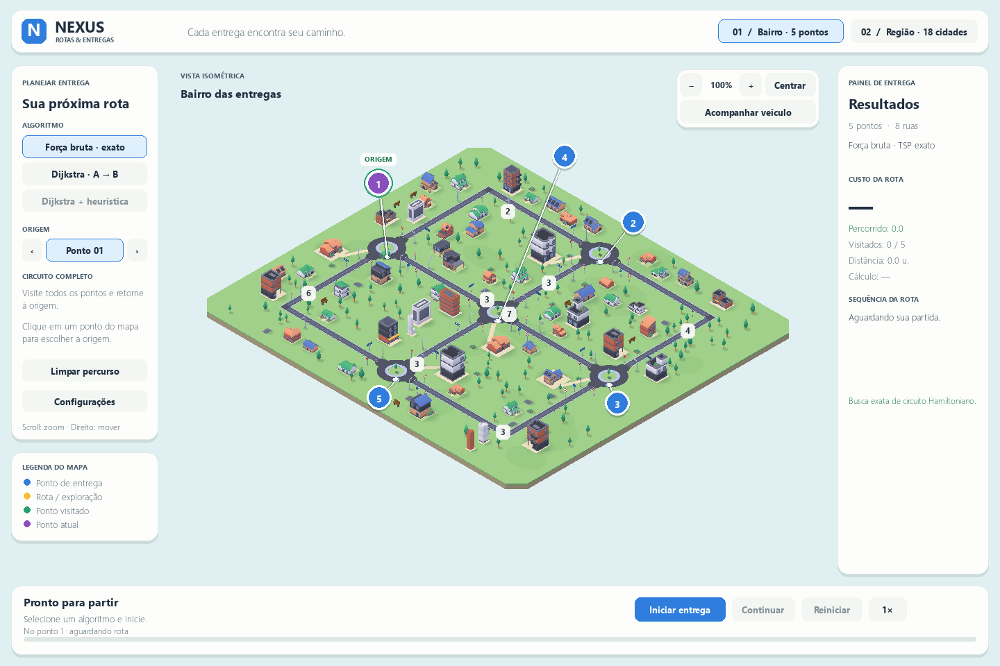
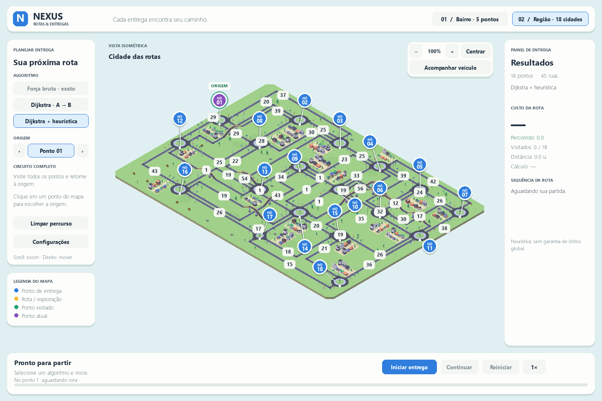
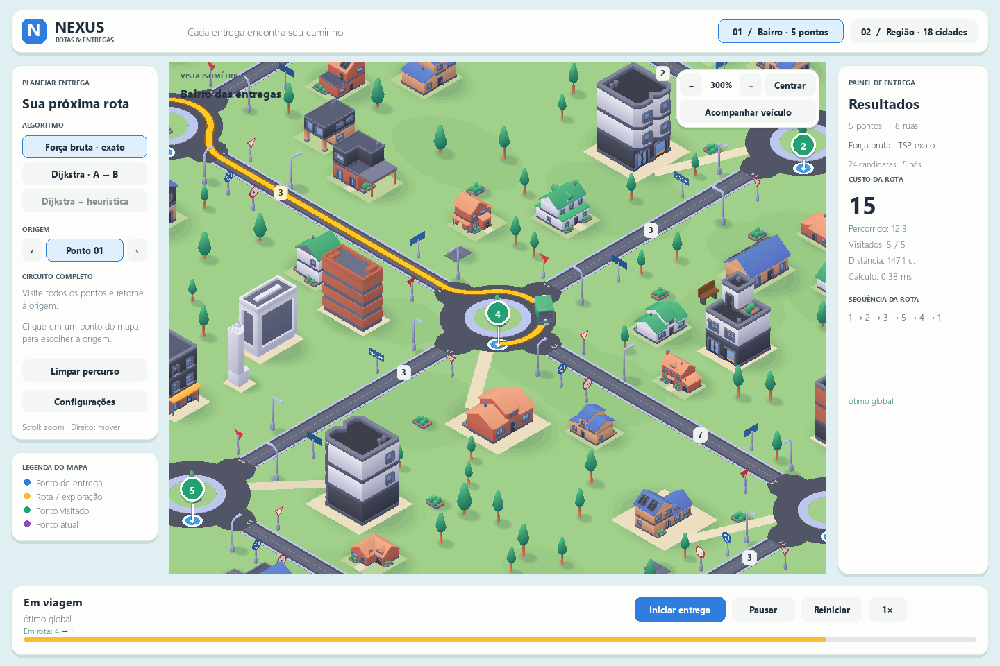
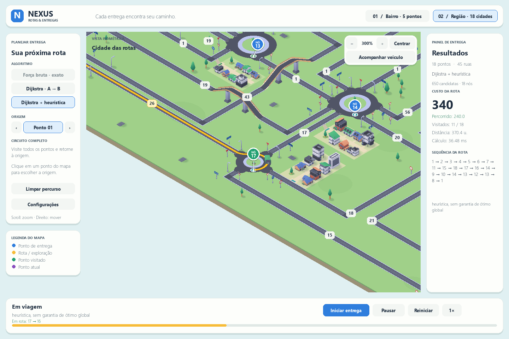

# Rotatórias em todos os cruzamentos reais

A auditoria dos dois mapas identificou **23 cruzamentos reais**. No bairro, os cinco nós têm três ou quatro acessos. Na região, os 18 nós têm de três a sete acessos. Cada um recebeu uma rotatória que usa os braços das ruas incidentes do grafo. Os 13 cruzamentos em projeção entre ruas sem ligação na região continuam separados por passagens elevadas.

| Mapa | Nós e arestas | Rotatórias | Acessos | Custo do circuito |
| --- | --- | --- | --- | --- |
| Bairro | 5 nós, 8 arestas | 5 | 16 | 15, exato |
| Região | 18 nós, 45 arestas | 18 | 90 | 340, heurístico |

O pavimento reutiliza a textura do City Kit Roads e recorta cada rua no encaixe da rotatória. O raio do eixo do anel varia de 1,75 a 2,445 unidades conforme os acessos. A pista tem 0,95 unidade no anel e nas bocas, com uma abertura gradual no interior de cada encaixe para dar folga às rodas da van. O meio-fio da ilha vem de `road-roundabout.obj`, e a vegetação usa `tree-small.obj` e `planter.obj`. As rotatórias receberam marcas de preferência, placas e postes nas margens disponíveis. As reservas das ilhas deixam os lotes fora da pista.

A van percorre as entradas e saídas por curvas tangentes e gira em sentido anti-horário no anel. O destaque amarelo usa os mesmos waypoints. O relógio de animação distribui o tempo pelo comprimento visual e desacelera na aproximação dos anéis. As viagens longas podem levar mais tempo na tela. O custo continua calculado pelos pesos originais.

## Capturas e demonstração

[Vídeo da van entrando e saindo da rotatória do nó 4, 3,33 s em 1×](capturas/van-na-rotatoria.mp4)

## Verificação

- Na base `697c915`, passaram os 23 testes de grafos, contratos e algoritmos. A comparação posterior de **372 casos** de Dijkstra e dos circuitos, para todas as origens dos dois mapas, produziu os mesmos caminhos, custos e estados de término.
- Os arquivos em `data/`, `tsp_core.py`, `solvers.py` e `roteamento3d.py` estão idênticos aos da base. A aresta **9–14 mantém peso 1**.
- `python -m unittest discover -s tests -q` passou com **106 testes**. A suíte geométrica verifica os 106 acessos, as bocas do pavimento, a folga para as rodas, as âncoras e o espaçamento entre anéis. Os testes do relógio verificam as chegadas e o custo em 1×, 2× e 4×.
- `python scripts/smoke_3d.py` passou em **1440 × 960** e **1100 × 760**. Conferiu os pesos e marcadores a 65% e a 100%, a câmera em acompanhamento a 300% e o retorno da van à origem. O teste acompanhou 469 quadros no bairro e 1.065 na região a 4× em cada resolução.
- Para reproduzir as capturas, execute `python scripts/smoke_3d.py`. Para gerar o vídeo em `tmp/3d-review/`, execute `python scripts/smoke_3d.py --demo` com FFmpeg disponível.

## Arquivos alterados

| Arquivo | Alteração |
| --- | --- |
| `rotatorias3d.py` | Braços com posições e recortes independentes, dimensões variáveis e curvas de circulação. |
| `geometria3d.py` | Identificação dos nós incidentes e ajuste do perfil de movimento. |
| `render3d.py` | Pavimento, vegetação, sinalização, postes e duração visual dos percursos. |
| `mundo3d.py`, `tsp_3d.py` | Relógio de animação com duração por trecho e custo preservado. |
| `hud.py` | Pesos posicionados a partir das ruas entre as rotatórias. |
| `tests/test_layout_visual.py`, `tests/test_mundo3d.py`, `tests/test_render3d.py`, `tests/test_integracao.py` | Validação de encaixes, circulação, velocidades e sinalização. |
| `scripts/smoke_3d.py` | Acompanhamento dos circuitos com as novas durações, capturas e gravação. |
| `README.md`, `docs/rotatorias-cruzamentos/` | Relatório, capturas e vídeo. |
