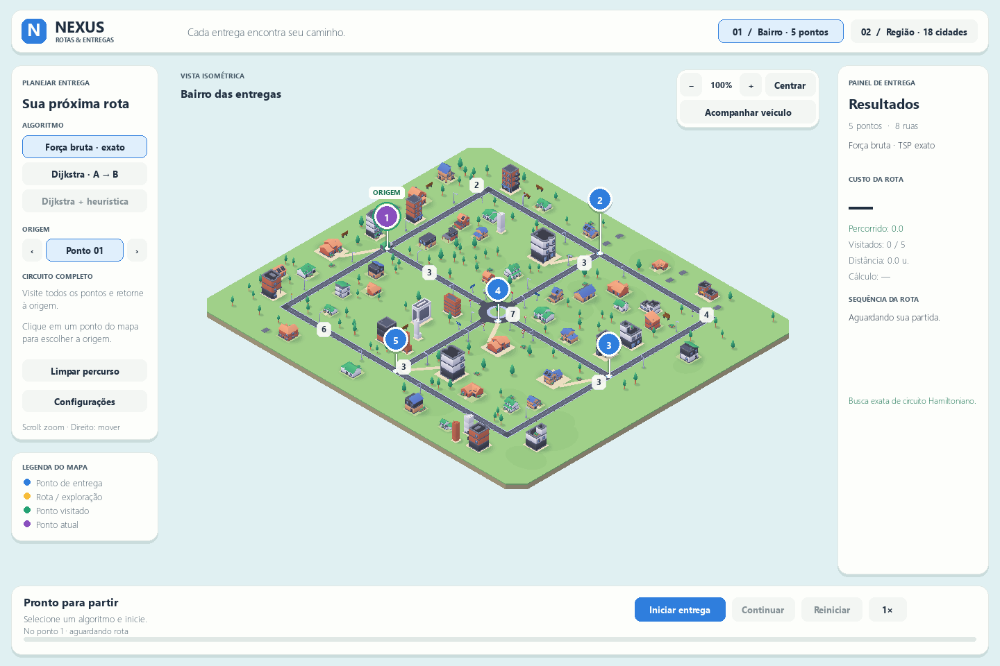
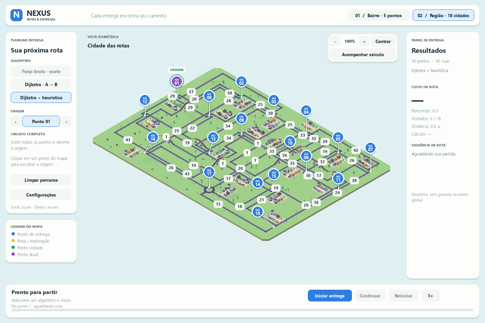
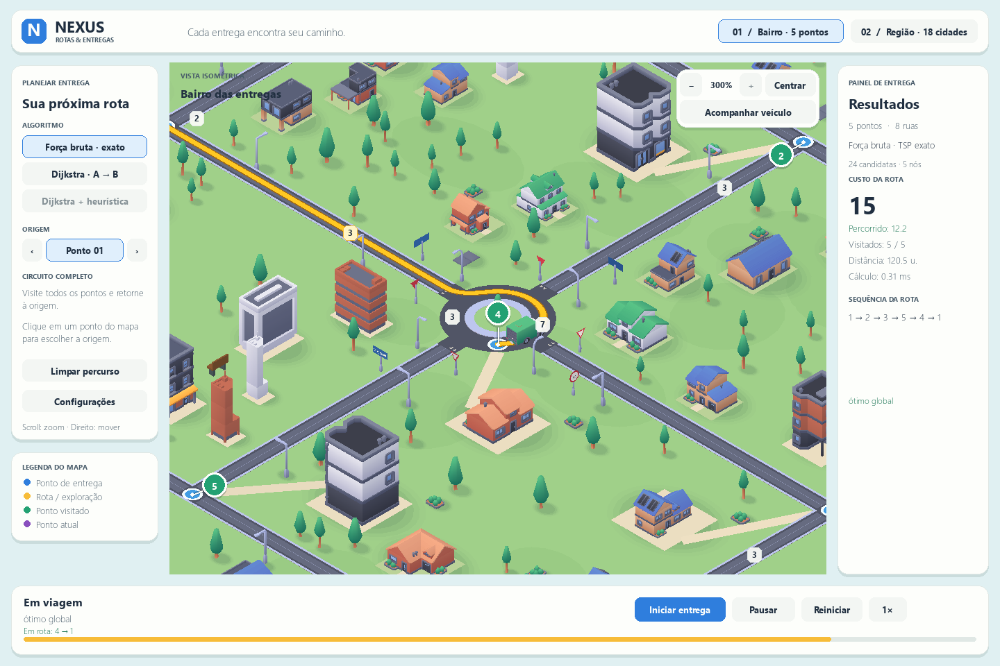
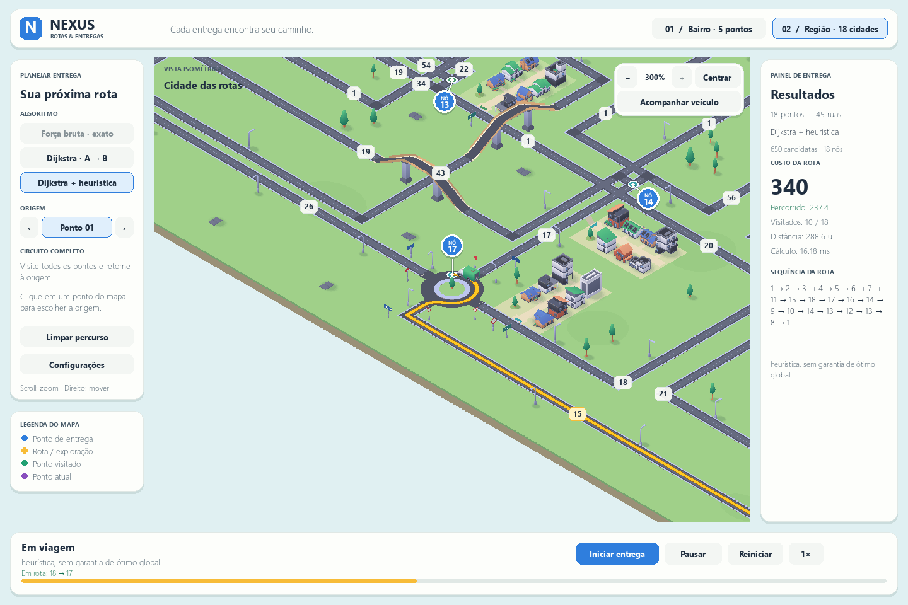

# Rotatórias e sinalização do NEXUS 3D

O cruzamento do nó **4** no bairro e o do nó **17** na região agora têm rotatórias de quatro braços. Cada uma tem pista de 0,95 unidade, ilha com grama e árvore e marcações de preferência. O trecho 16–17 ficou reto. Os acessos 15–17 e 17–18 chegam por braços distintos, com espaço para a calçada do nó 17. A região continua em uma ilha de 98,1 × 71,1 unidades.

Os trajetos de entrada e saída usam curvas tangentes ao anel em sentido anti-horário. A van desacelera nas aproximações e no anel, seguindo os mesmos pontos usados pelo destaque amarelo. O ponto de chegada e o marcador ficam na pista circular. O relógio lógico e os custos continuam usando os pesos das arestas originais.

## Sinalização instalada

| Cenário | Postes | Preferência | Direção | Limite | Curvas | Identificação de cidade |
| --- | ---: | ---: | ---: | ---: | ---: | ---: |
| Bairro de 5 nós | 24 | 4 | 3 | 1 | 4 | 0 |
| Região de 18 nós | 49 | 4 | 3 | 1 | 7 | 14 |

Os postes seguem as margens das retas e as aproximações das rotatórias. Na região, também há um poste próximo a uma ponte. As placas de identificação ficam nas entradas com espaço livre para instalar o painel.

## Assets locais

| Modelo | Uso |
| --- | --- |
| `road-roundabout` | Meio-fio interno recortado da peça Kenney, com pavimento modular ajustado à largura das ruas do jogo. |
| `road-straight`, `road-crossroad` | Retas e cruzamentos restantes. O atlas de asfalto do kit também colore o anel. |
| `light-curved`, `light-square` | Postes de 1,55 unidade, próximos às vias e às rotatórias. |
| `road-sign-empty` | Hastes das placas de preferência, direção, velocidade e cidade. As faces e inscrições são desenhadas pelo jogo. |
| `road-sign-warning` | Advertência nas curvas. |
| `tree-small` | Vegetação da ilha central. |

Referências consultadas. [City Kit (Roads)](https://kenney.nl/assets/city-kit-roads) · [3D Road Tiles](https://kenney.nl/assets/3d-road-tiles) · [Catálogo Kenney](https://kenney.nl/assets)

## Capturas

## Validação

- Antes das alterações, passaram os 23 testes de grafos, contratos e solvers e o smoke 3D. A comparação com `6a88ff5` confirmou que `data/`, `tsp_core.py`, `solvers.py` e `mundo3d.py` permaneceram idênticos.
- O bairro continua com **5 nós e 8 arestas**, e a região com **18 nós e 45 arestas**. A aresta **9–14 mantém peso 1**. O circuito exato do bairro continua com custo **15**, e o heurístico da região com custo **340**.
- `python -m unittest discover -s tests -q` passou com **105 testes**. A suíte verifica as bocas de entrada, a largura da pista, a passagem ao redor da ilha, a desaceleração, a reserva dos lotes e a distância da sinalização às vias.
- `python scripts/smoke_3d.py` passou em **1440 × 960** e **1100 × 760**. Verificou a viagem completa com acompanhamento a 4×, a visibilidade dos marcadores e pesos e o posicionamento da van sobre a pista. O smoke gera as quatro capturas em `tmp/3d-review/`.

## Arquivos alterados

| Arquivo | Alteração |
| --- | --- |
| `rotatorias3d.py` | Malha modular, curvas de entrada e saída e trajetos direcionados no anel. |
| `geometria3d.py` | Braços do nó 17, âncoras de chegada e perfil de desaceleração visual. |
| `cidades3d.py` | Planejamento de lotes e calçadas junto ao pavimento e às reservas das rotatórias. |
| `render3d.py`, `assets3d.py` | Recorte do meio-fio Kenney, ilha, marcações, postes e placas. |
| `tsp_3d.py`, `hud.py` | Animação, progresso pela distância real, ancoragem do marcador e proteção das etiquetas. |
| `tests/`, `scripts/smoke_3d.py` | Testes do traçado e capturas dos dois mapas e das rotatórias. |
| `README.md`, `docs/rotatorias/` | Relatório, inventário e capturas. |
