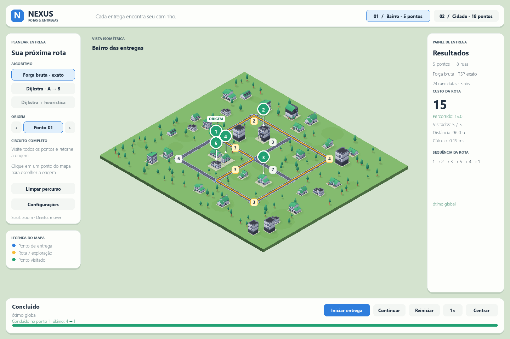
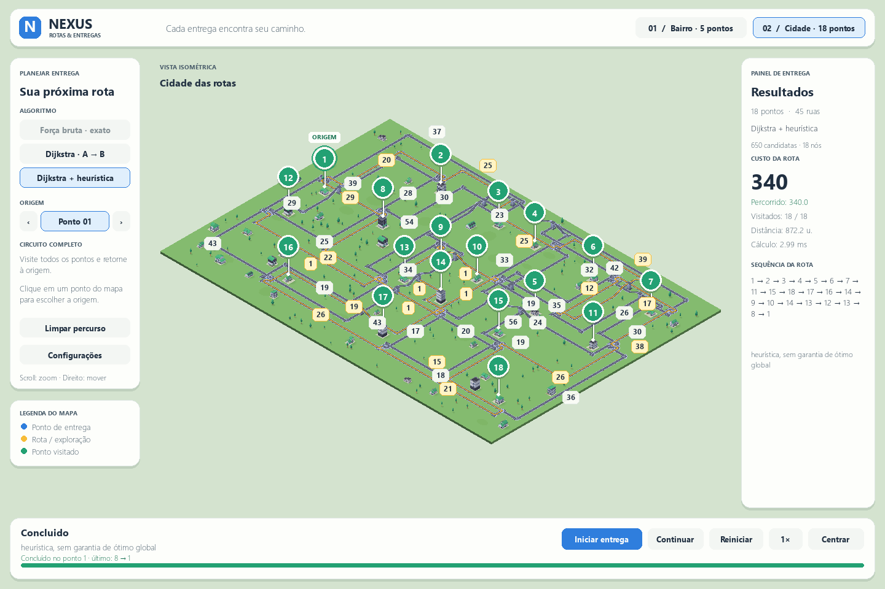
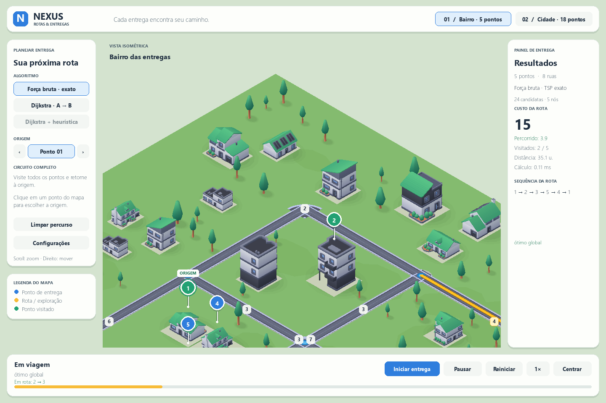

# Validação da implementação

Executada em 16/11/2026 na branch `caixeiro3D`, Windows, Python 3.14.0,
Panda3D 1.10.16 e pygame-ce 2.5.8. Os resultados abaixo pertencem a esta
implementação; os números históricos do projeto irmão não foram reutilizados.

## Testes automatizados

```powershell
.\.venv\Scripts\python.exe -m unittest discover -v
```

**82 testes aprovados**, sem falhas. A execução completa mais recente durou
48,325 segundos. A descoberta padrão é habilitada por `tests/__init__.py`.
As verificações incluem:

- Listas exatas de 8 e 45 arestas, nós de 1 a 5 e de 1 a 18, simetria,
  conectividade e as três correções do usuário.
- Dijkstra comparado com um oráculo independente Floyd–Warshall em **349 pares**
  de origem/destino, incluindo origem igual ao destino.
- Circuitos heurísticos validados para **todas as 23 origens** dos dois mapas:
  cobertura, retorno e soma de cada aresta efetivamente percorrida.
- Ótimo de custo **15** por força bruta em todas as cinco origens do mapa menor;
  bloqueio do método para grafos maiores que nove nós.
- Melhoria 2-opt, expansão do fecho métrico, cancelamento cooperativo,
  desconexão e preservação dos dados de entrada.
- Materiais, texturas, UVs, cache e normalização dos modelos Kenney reais.
- Malhas da cidade, ruas correspondentes às arestas, decoração afastada das
  ruas e nós, realce independente e limpeza ao reconstruir cenários.
- Enquadramento, zoom, arraste normal e extremo, mantendo interseção visível
  do mapa nos limites de câmera.
- Enquadramento da ilha inteira nos mapas de 5 e 18 nós, com as ruas, volumes
  dos prédios e âncoras dos marcadores dentro do viewport.
- Pausa, reinício, chegadas, velocidades, grande delta de tempo, percurso
  unitário, orientação corrigida, antecipação de curvas, rampas e retorno físico
  do veículo à origem.
- Layout do HUD em 1100×760, 1100×880 e 1440×960, captura de cliques pelo
  diálogo, seleção pelos badges, distâncias dos 18 nós, rota longa e alfa/cor
  da textura após otimização BGRA.
- Integração assíncrona, pausa da reprodução da busca, cancelamento e troca
  de mapa sem reaproveitar resultados de uma execução anterior.
- Trecho ativo da van e disponibilidade correta dos algoritmos em cada mapa.

## Renderização e integração reais

```powershell
.\.venv\Scripts\python.exe scripts\smoke_3d.py
.\.venv\Scripts\python.exe scripts\smoke_3d.py --janela
```

O primeiro comando usa os componentes reais do jogo em um framebuffer OpenGL.
Os dois mapas passaram em **1440×960 e 1100×760**, com rota, custos, chegadas,
pausa/retomada, reinício, 2×/4×, enquadramento, seleção por clique, diálogos,
cancelamento e troca durante a busca. Apenas um veículo permanece na cena
depois das trocas. O modo de distâncias exibe todos os 18 nós na resolução mínima.

| Caso | Percurso/custo observado |
| --- | --- |
| TSP exato, mapa 5, origem 1 | 1 → 2 → 3 → 5 → 4 → 1; **15** |
| Circuito heurístico, mapa 18, origem 1 | **340**, 18 nós visitados, retorno físico à origem |
| Dijkstra, mapa 18, 14 → 9 | 14 → 9; **1** |
| Dijkstra, mapa 18, 1 → 18 | 1 → 12 → 13 → 14 → 17 → 18; **63** |
| Dijkstra, origem igual ao destino | Custo zero, nó marcado como visitado, execução concluída |

Circuito heurístico obtido:

```text
1 → 2 → 3 → 4 → 5 → 6 → 7 → 11 → 15 → 18 → 17 → 16
  → 14 → 9 → 10 → 14 → 13 → 12 → 13 → 8 → 1
```

O segundo comando abre uma janela nativa brevemente, solicita redução extrema
para 300×120, verifica a restauração automática para 1100×760 e fecha pela
propriedade nativa de janela. A abertura,
redimensionamento do HUD e encerramento do laço de tarefas passaram. O botão
de fechar e `Esc` encerram o executor e os recursos gráficos.

As capturas foram inspecionadas visualmente, incluindo os dois mapas durante
a viagem, resultado final, configurações, distâncias na resolução mínima e a
van numa curva.
O script salva capturas e resultados em `tmp/3d-review/` (diretório ignorado
pelo Git). Duas capturas da entrega também estão preservadas abaixo:







## Desempenho e ajustes finais

O perfil identificou uma conversão dispendiosa de RGBA na textura do HUD.
Usar BGRA tanto na extração do Pygame quanto no envio ao Panda3D preservou
cores/transparência e reduziu a mediana isolada de HUD + renderização de cerca
de **130 ms para 15 ms** no ambiente observado (NVIDIA RTX 3050). A cena estática
é consolidada e modelos/texturas são compartilhados.

O smoke completo mais recente, com atualização do HUD em cada amostra e outros
processos do ambiente ativos, registrou medianas de **28,18 ms em 1440×960** e
**20,71 ms em 1100×760** em 30 amostras. Esses tempos são medidas desse
procedimento, não uma garantia de FPS em outros computadores. O laço interativo
é limitado a 60 Hz e o HUD atualiza a 30 Hz.

A validação também corrigiu o limite de pan para manter parte do mapa visível,
preservou o ajuste nativo de `pixel2d` ao redimensionar e garantiu o encerramento
do laço quando a janela é fechada. Grandes pausas na renderização não fazem
o veículo saltar segundos de simulação. Documentação e observações dos dados
foram atualizadas para refletir as 45 arestas confirmadas, com UTF-8 correto.
Reduções da janela abaixo da área dos painéis solicitam o mínimo e aguardam
o próximo tamanho válido, sem lançar erro nem gerar um viewport de área negativa.

## Limites conhecidos

- A heurística do mapa de 18 nós não garante ótimo global; o custo 340 é o
  resultado da estratégia determinística implementada para origem 1.
- A interface requer pelo menos 1100×760 e um contexto OpenGL. O framebuffer
  fora da tela emitiu um aviso de propriedades gráficas disponíveis diferentes
  das solicitadas, sem falha de renderização; não se promete antialiasing igual
  em todos os drivers.
- Sombras são de contato. Não há sistema de trânsito, colisões entre veículos
  ou correspondência obrigatória entre comprimento geométrico e peso lógico.
- O jogo carrega OBJ/MTL, mantendo o caminho compatível com a base existente;
  não há importador GLB/FBX em execução. Esses arquivos locais foram preservados.

## Execução por tarefa

As doze tasks de `prompt_refinamento_game_3d_nexus_tsp.md` foram registradas em
commits separados. Cada commit usou uma lista explícita de caminhos staged; as
duas remoções preexistentes em `ref/` e os outros projetos do workspace foram
preservados.

O runtime não disponibilizou GPT-6 Astra nem GPT-6.1 Sol nesta sessão; o pedido
ao Astra foi recusado como modelo não suportado. A implementação delegada usou
o agente Terra disponível como alternativa. O fluxo de commits foi delegado e
os caminhos staged foram conferidos; o runtime não expôs o identificador do
modelo desse agente, então não atribuo um nome de modelo sem confirmação.
