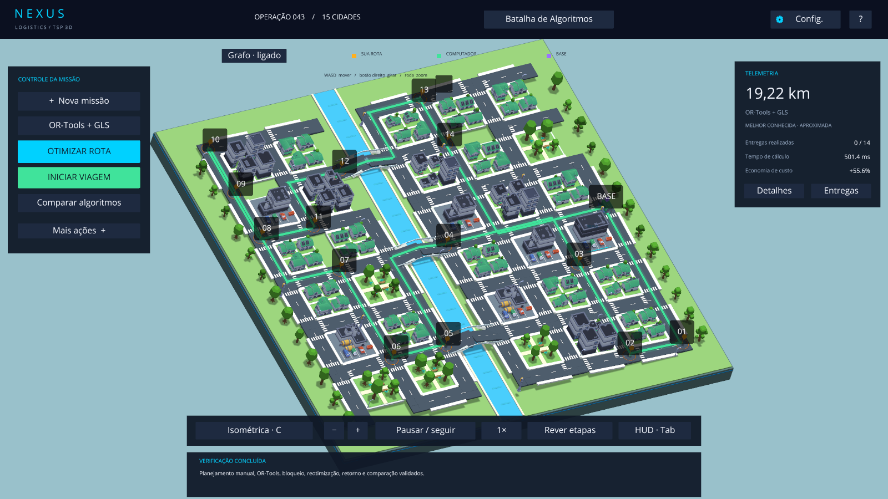
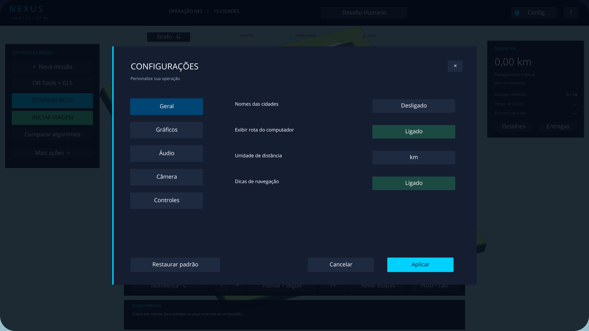

# TSP 3D — O Desafio da Rota Perfeita

Jogo desktop educativo de logística em Python, inteiramente em português brasileiro.
Planeje as entregas da **NEXUS LOGISTICS**, compare algoritmos de verdade e acompanhe
o caminhão percorrendo uma cidade 3D procedural até retornar ao depósito.



O código usa nomes, comentários e explicações em português. Nomes exigidos pelas
bibliotecas, como `update()`, `RoutingModel` e `GUIDED_LOCAL_SEARCH`, conservam sua
grafia original. Os modelos e texturas gratuitos usados no cenário acompanham o
projeto; não é preciso baixar pacotes gráficos separadamente. Consulte
[assets/README.md](assets/README.md) para autoria, licenças e procedência.

## Instalação e execução

Recomendado: **Python 3.12 de 64 bits**, Windows 10/11 e uma placa com suporte a
OpenGL. O motor também pode funcionar em Linux e macOS com as bibliotecas compatíveis;
a validação desta entrega foi feita no Windows com Python 3.12.

No PowerShell, dentro desta pasta:

```powershell
python -m venv .venv
.\.venv\Scripts\python.exe -m pip install -r requirements.txt
.\.venv\Scripts\python.exe main.py
```

Se `python` apontar para uma versão sem wheels das dependências, use o executável
do Python 3.12 no primeiro comando. Não é necessário ativar o ambiente virtual.
`requirements-lock.txt` registra as versões usadas na validação desta entrega.

Com o ambiente já instalado, também é possível abrir **iniciar.bat** com dois cliques
ou executar `./iniciar.ps1`. A primeira missão contém **15 cidades, incluindo a base**,
e usa a semente 42. São 14 entregas e um retorno ao depósito.

```powershell
# Outra missão reproduzível
.\.venv\Scripts\python.exe main.py --cidades 25 --semente 2026 --tempo 3

# Comparar todos os métodos no terminal, incluindo o exato
.\.venv\Scripts\python.exe main.py --sem-interface --comparar --cidades 8 --tempo 0.3

# Exemplo com distâncias geométricas
.\.venv\Scripts\python.exe main.py --euclidiano

# Reabrir a rede de uma missão exportada (não retoma uma viagem em andamento)
.\.venv\Scripts\python.exe main.py --carregar resultados/missao_42_DATA.json
```

## Como jogar

1. Abra **Nova missão**, escolha a dificuldade ou digite de 3 a 100 cidades e uma
   semente; clique em **Gerar mapa**. As opções detalhadas ficam nessa janela para
   deixar mais espaço para a cidade.
2. No **Desafio Humano**, clique nos marcadores elevados ou nos destinos da lista.
   Cada clique acrescenta uma entrega; a última seleção fecha automaticamente o ciclo.
3. Clique em **Iniciar viagem** para executar a rota ou em **Otimizar rota** para
   calcular uma alternativa. Sua rota manual continua desenhada em laranja.
4. No modo **Inteligência Artificial**, a otimização reproduz etapas realmente
   registradas pelo algoritmo e inicia a viagem quando a reprodução termina.
   O botão Iniciar viagem permite pular a reprodução educativa.
5. **Comparar algoritmos** executa os métodos sobre os mesmos destinos e custos,
   abre o ranking e permite escolher qual rota desenhar no mapa.
6. Em **Mais ações**, use **Bloquear uma rua** ou **Obras: custo ×2** para experimentar uma reotimização.
   Os eventos desta versão escolhem um trecho reproduzível. Um bloqueio não remove
   uma ligação que isolaria a rede naquele momento.
7. Em **Mais ações**, **Salvar missão / JSON** exporta o grafo, os pesos, bloqueios, configurações e
   resultados. O ranking também exporta um gráfico PNG com Matplotlib.

A lista de destinos é paginada. Os seletores de modo, algoritmo, base, dificuldade,
tempo de cálculo e velocidade alternam entre suas opções a cada clique.

A HUD reúne planejamento, telemetria e sequência de entregas em painéis compactos.
Os comandos de câmera, zoom e velocidade ficam junto à área do mapa. Use **Tab**
para ocultar ou exibir a HUD durante a observação da viagem; os atalhos de teclado
continuam disponíveis quando nenhum campo ou modal está em edição.

| Controle | Ação |
|---|---|
| Mouse esquerdo | Selecionar um marcador ou comando |
| Botão direito + arrastar | Girar a câmera |
| Roda do mouse | Aproximar / afastar |
| WASD / botão do meio + arrastar | Deslocar a câmera; as setas podem substituir WASD nas configurações |
| C | Alternar isométrica, aérea e seguir veículo |
| G | Exibir / ocultar nós e arestas |
| Espaço | Pausar / continuar a viagem ou as etapas |
| O / B | Otimizar / comparar |
| N / R | Nova semente / reiniciar a mesma missão |
| Backspace | Desfazer a última entrega planejada |
| F10 | Abrir Configurações |
| Tab | Exibir / ocultar a HUD |
| H / Esc | Ajuda / fechar painel ou sair do jogo |

## Configurações da experiência

Abra **Configurações** pelo controle de engrenagem da HUD ou por **F10**. O modal
possui cinco categorias:

| Categoria | Opções |
|---|---|
| Geral | Nomes das cidades, rota do computador, unidade em km/m e dicas de navegação |
| Gráficos | Densidade de decoração, sombras e brilho das rotas e entregas |
| Áudio | Ativação e volume dos sinais de entrega e conclusão |
| Câmera | Sensibilidade, suavização e inversão do giro horizontal |
| Controles | Escolha entre WASD e setas para deslocamento; consulta dos demais atalhos |

**Aplicar** confirma e salva as alterações. **Cancelar**, o botão de fechar e
**Esc** descartam a edição. **Restaurar padrão** preenche os valores padrão no
modal; use Aplicar para confirmá-los. Alterar a qualidade reconstrói a decoração,
preservando a rede, as entregas e o planejamento da missão.

As preferências são gravadas em `config/preferencias_usuario.json`, arquivo local
ignorado pelo Git, separado dos valores iniciais de `config/settings.json`.
Preferências ausentes ou inválidas utilizam os padrões do aplicativo. A seleção
de unidade muda a apresentação das distâncias; os custos e algoritmos continuam
usando os mesmos dados da missão.



Os efeitos sonoros são sinais curtos originais incluídos em `assets/audio/`.
Não há música de fundo. Eles podem ser desativados na categoria Áudio.

## Modelagem e correção matemática

- A região é um `networkx.Graph` não direcionado. Cidades são um subconjunto de
  uma rede maior de cruzamentos. Cada nó guarda sua posição 3D; cada rua guarda
  geometria, distância física, custo, multiplicador e estado de bloqueio.
- A geração usa uma instância local de `random.Random(semente)`. As ruas ocupam
  as bordas das quadras, enquanto edifícios, parques e montanhas ocupam o interior.
  O rio só é atravessado nos trechos explicitamente marcados como pontes.
- No **modo rodoviário**, Dijkstra calcula os menores custos entre destinos.
  A matriz guarda também os caminhos completos e a distância física do caminho
  escolhido. A otimização decide a ordem das entregas; a animação expande cada
  ligação da solução nos trechos reais da rede.
- Passar por uma cidade durante um caminho mínimo **não confirma a entrega**.
  O serviço acontece somente no destino final de cada perna planejada. Repetir
  cruzamentos e passar por cidades intermediárias é permitido.
- No **modo euclidiano**, os custos são distâncias geométricas 3D. A animação usa
  um drone e uma camada elevada de rotas para representar essa abstração, sem
  tratar linhas diretas como ruas. Eventos rodoviários ficam restritos ao modo rodoviário.
- A escala inicial é 100 metros por unidade da cena. Sem obras, uma unidade de
  custo (u.c.) corresponde a um metro. Obras multiplicam o **custo**, preservando
  o comprimento físico; por isso menor custo e menor distância podem diferir.
- Custos físicos e econômicos são validados antes da execução: destinos únicos,
  retorno ao depósito, soma das matrizes, caminhos existentes, bloqueios e revisão
  do cenário. Redes desconectadas produzem uma mensagem de erro, nunca um atalho fictício.

| Algoritmo | Implementação e garantia |
|---|---|
| Vizinho mais próximo | Construção gulosa, com decisões registradas; sem garantia de ótimo |
| 2-opt | Parte do vizinho mais próximo e aceita trocas que reduzem o custo; registra conexões e custos antes/depois |
| OR-Tools + GLS | `RoutingIndexManager`, `RoutingModel`, `PATH_CHEAPEST_ARC`, `GUIDED_LOCAL_SEARCH`; um veículo e tempo configurável |
| Held–Karp | Programação dinâmica exata; até 12 cidades por padrão; só declara ótimo após concluir a prova |
| Christofides | Implementação do NetworkX, com árvore mínima, emparelhamento, circuito euleriano e atalhos; verifica simetria e desigualdade triangular |

O OR-Tools recebe custos inteiros após multiplicar a matriz por 1000 e arredondar
(precisão de 0,001 u.c.). As métricas apresentadas são recalculadas na matriz de
ponto flutuante original. A aplicação **não declara ótimo global** para GLS, 2-opt,
vizinho mais próximo ou Christofides.

Christofides mostra o limite de **1,5× o custo ótimo** apenas quando as hipóteses
métricas foram verificadas. Seu painel educativo apresenta as estruturas realmente
calculadas. Para OR-Tools, somente melhorias incumbentes observadas em callbacks são
registradas, até 160 quadros de reprodução; o contador considera todas as melhorias
observadas. A tela de cálculo informa o algoritmo e o tempo decorrido, sem porcentagem
de progresso inventada. O tempo de preparação da matriz não integra o tempo do solver.

**Concorde, LKH, genéticos, colônia de formigas e recozimento simulado são futuros.**
O contrato `Estrategia` e o registro central permitem integrar novos solucionadores;
selecionar um nome sem implementação gera um erro explícito.

## Eventos, pontuação e comparação

Durante uma viagem, o evento aguarda o próximo cruzamento. O veículo termina seu
trecho atual e fica parado nesse nó enquanto o processo trabalhador recalcula
**posição atual → destinos restantes → depósito** com OR-Tools.

As entregas já realizadas e a distância acumulada são preservadas. Se o veículo
estiver em uma cidade ainda pendente, essa cidade pode ser atendida como primeira
entrega explícita da nova sequência. Esse problema tem origem e fim potencialmente
distintos e é identificado como **reotimização dinâmica**, fora do ranking de ciclos
completos. O custo exibido nessa situação é o custo da rota restante.

A pontuação estática vai até 1000: 700 pontos de eficiência relativa à melhor
solução conhecida, 200 de cobertura das entregas e 100 de conclusão com retorno.
Uma referência aproximada continua identificada como melhor conhecida. Viagens
reotimizadas não recebem pontuação comparativa contra ciclos anteriores.

Economia = `(custo inicial − custo atual) / custo inicial × 100`. A base é a rota
manual, quando disponível, ou a ordem inicial dos destinos gerados. O combustível
estimado usa distância física, consumo e preço do litro configuráveis. No ranking,
tempo, distância, custo, economia e melhorias disponíveis são mostrados por método.

## Arquitetura e configurações

```text
main.py                    Entrada desktop e modo terminal
config/settings.json       Valores iniciais e limites
config/preferencias_usuario.json  Preferências locais (não versionadas)
assets/                    Modelos GLB, texturas, licenças, manifesto e áudio
tools/gerar_audio.py        Geração dos sinais sonoros originais
tsp_3d_game/
  app.py                   Coordenação do jogo e eventos
  core/                    Grafo, geração, matrizes, validação, movimento e JSON
  algorithms/              Cinco estratégias e contrato de integração
  graphics/                Mundo procedural, câmera, veículo e rotas
  ui/                      HUD, configurações, ranking, ajuda e gráficos
tests/                     Testes matemáticos, físicos e do processo trabalhador
```

O trabalhador usa `multiprocessing` com o método **spawn**, filas e eventos de
cancelamento. Não importa Ursina nem cria entidades gráficas. Cada pedido recebe
um identificador e respostas antigas são descartadas ao trocar a missão. O processo
mantém um cache limitado de matrizes e caminhos, cuja chave inclui os destinos, a
modalidade e uma assinatura dos pesos e bloqueios da rede.

O `update()` consome resultados prontos e atualiza câmera, veículo e interface.
Os cálculos combinatórios e Dijkstra ficam no trabalhador. O catálogo de assets
reutiliza os modelos GLB carregados e seus recursos. A geometria estática é agrupada
em regiões de 3 × 3 quadras, com estados de renderização compartilhados para reduzir
chamadas de desenho. Textos e objetos interativos permanecem independentes, e cenas
substituídas são destruídas.
O limite inicial de destinos é 100 para manter a primeira versão
utilizável; o modo especialista começa em 50.

Edite `config/settings.json` para ajustar cidades, semente, limite do método exato,
tempo do solver, velocidade, combustível e tamanho da janela. Subir o limite de
Held–Karp aumenta exponencialmente o consumo de memória. Ao atingir o prazo antes
de terminar, ele informa que não concluiu a prova.

## Testes e verificação gráfica

```powershell
.\.venv\Scripts\python.exe -m pip install -r requirements-dev.txt
.\.venv\Scripts\python.exe -m pytest -q

# Abre a janela, exercita o fluxo e salva uma captura antes de sair
.\.venv\Scripts\python.exe main.py --teste-grafico --tempo 0.3
```

Os testes verificam ótimos pequenos contra força bruta, custo e distância de cada
rota, retorno à base, hipóteses de Christofides, trocas 2-opt, bloqueios, redes
desconectadas, cache, geração reproduzível, trânsito sem entrega, pausa, posição
física do veículo, reotimização e comunicação com o trabalhador.

A verificação gráfica exercita geração de missão, configurações, seleção manual,
OR-Tools, câmeras, grafo, evento, reotimização, entrega de todos os destinos, retorno,
reinício e comparação. Também mede a mediana de FPS de uma cena estável. Salva
`resultados/verificacao_3d.png` e um relatório JSON. A pasta `resultados/` não é versionada.

## Referências técnicas

- [TSP e RoutingModel — Google OR-Tools](https://developers.google.com/optimization/routing/tsp)
- [Estratégias e limites de busca — OR-Tools](https://developers.google.com/optimization/routing/routing_options)
- [Christofides — NetworkX](https://networkx.org/documentation/stable/reference/algorithms/generated/networkx.algorithms.approximation.traveling_salesman.christofides.html)
- [API do Ursina](https://www.ursinaengine.org/api_reference.html)

